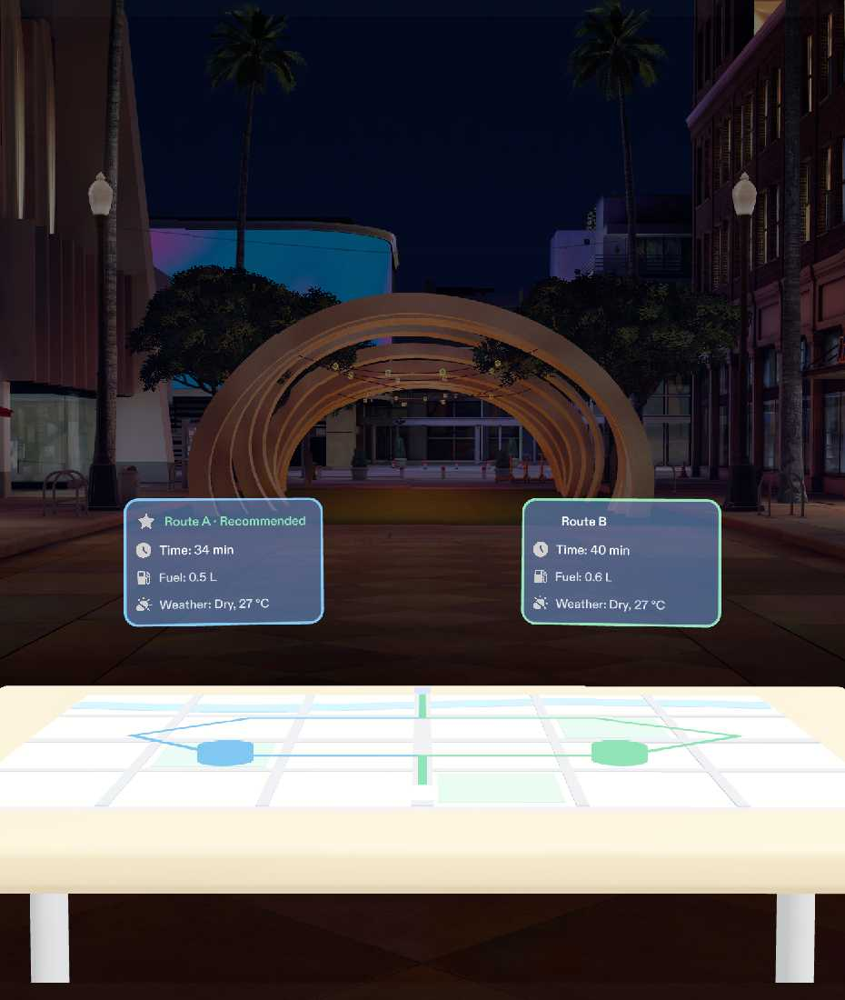
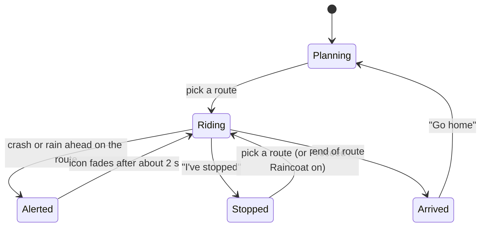
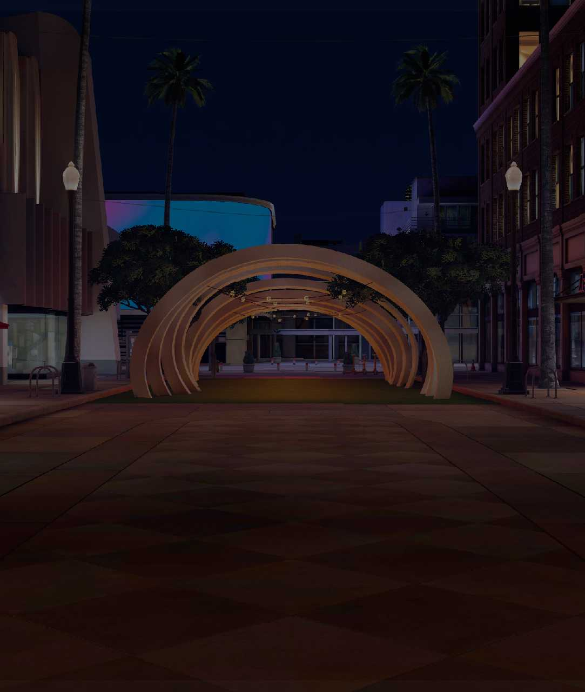
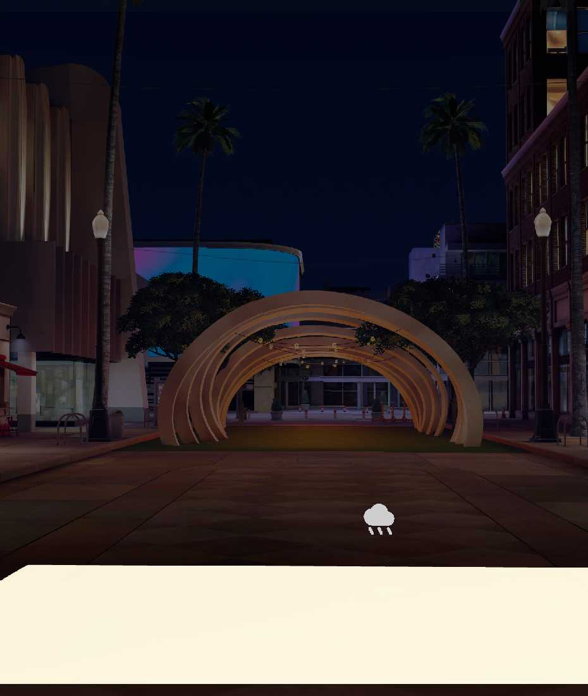
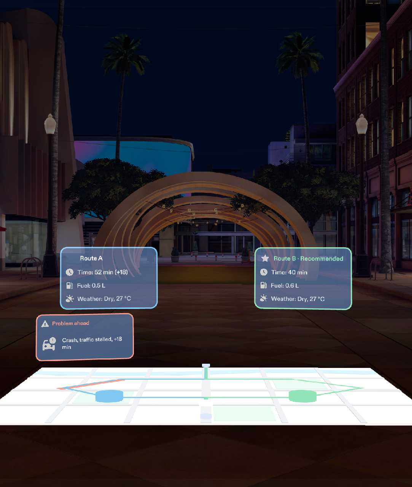
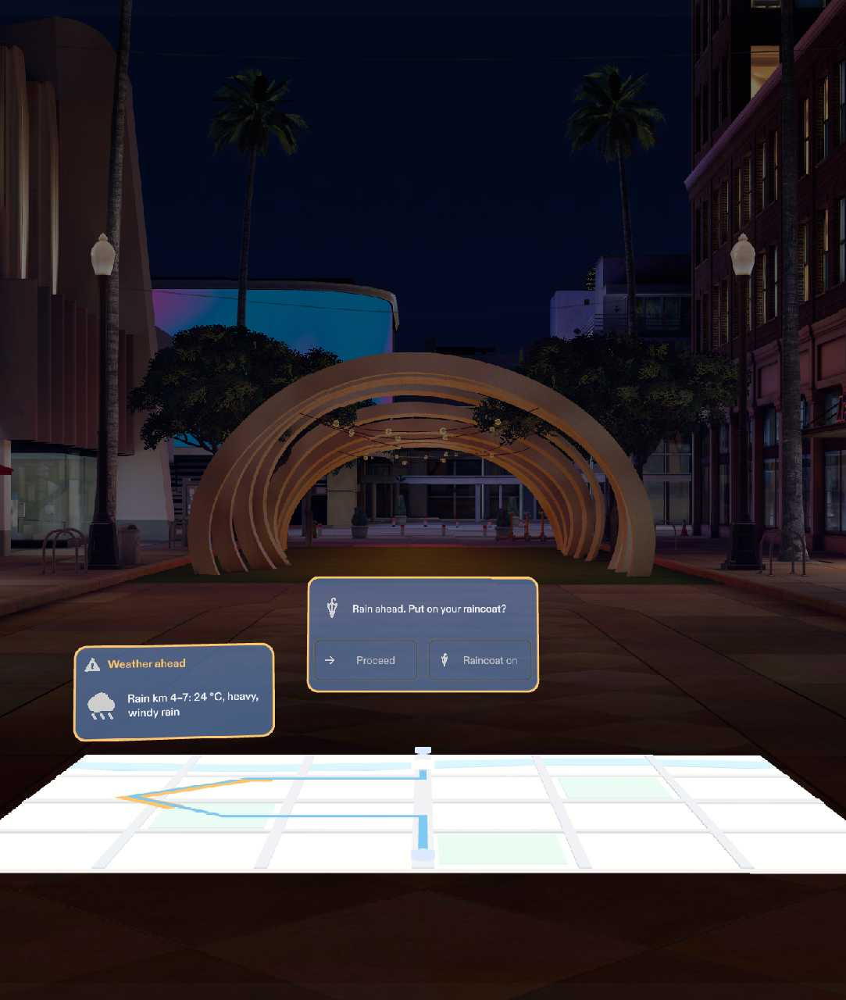
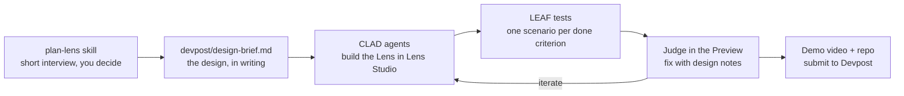
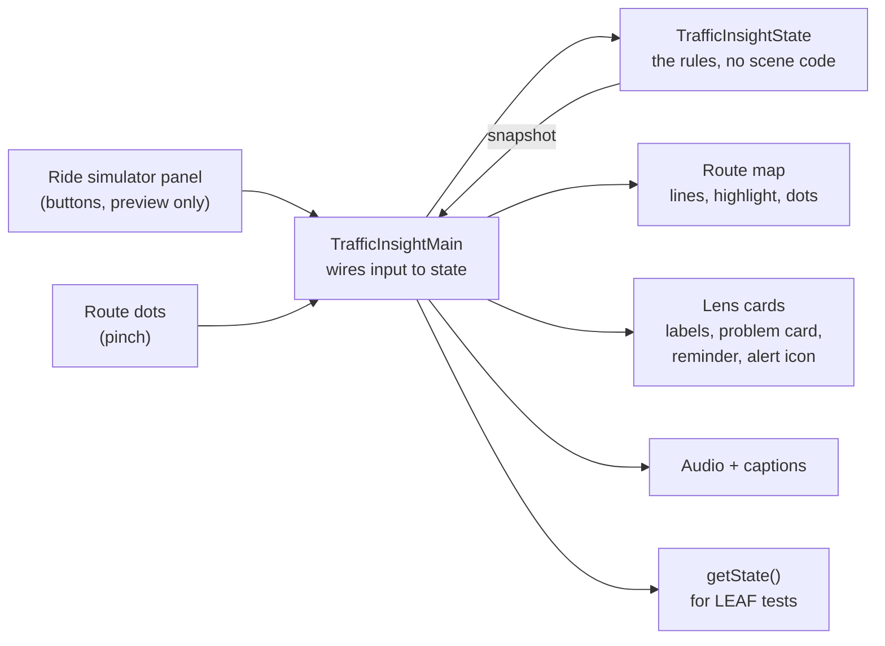

# TrafficInsight

**A commute co-pilot for motorcycle riders on Snap Spectacles.** While you ride, it stays out of your view and speaks only when something on your route needs you: a crash ahead, or rain coming. When you pull over, your route options appear laid out in front of you, compared by time, fuel and weather, and you pick one with a pinch.



Built for **Learn AR with SPECS, Round 2** (Devpost, sponsored by Snap Inc.). Planned with Devpost's `plan-lens` skill, built by an AI coding agent through Snap's CLAD plugin and the Lens Studio MCP, and demonstrated in Lens Studio's Interactive Preview. No Spectacles hardware is needed.

> **Status: the Lens is built and all six LEAF tests (C1 to C6) pass in the Lens Studio Preview.**
> Revision 1 is partly done: the table now shows only while planning, and the map floats when you stop. The progress marks and the route on the road ahead are not built yet (see the [Roadmap](#roadmap)).
> It has not been run on Spectacles hardware (none is available), and the demo video is not recorded yet. Everything below was run in the Preview unless it is marked _unverified_.

## Contents

- [What it does](#what-it-does)
- [Walkthrough](#walkthrough)
- [Tests](#tests)
- [Why it belongs on glasses](#why-it-belongs-on-glasses)
- [How this project is built](#how-this-project-is-built)
- [Design decisions made during the build](#design-decisions-made-during-the-build)
- [Known limitations](#known-limitations)
- [Repository layout](#repository-layout)
- [Run it yourself](#run-it-yourself)
- [How the agents are configured](#how-the-agents-are-configured)
- [Troubleshooting](#troubleshooting)
- [Roadmap](#roadmap)
- [The hackathon](#the-hackathon)
- [What I learned](#what-i-learned)
- [Credits and license](#credits-and-license)

## What it does

The demo tells one day in two trips that reuse the same map, alert and stop:

1. **Morning, at home.** A table is in the room and the map on it shows the trip to the office, with two routes compared by time, fuel and weather. The rider picks one.
2. **On the road.** Nothing on screen, and no table. Then a chime and a short sentence: a crash ahead has stalled traffic, pull over to see options. The rider pulls over, and the map floats in front of them with the crash stretch highlighted and the faster reroute. They pinch it and arrive on time.
3. **Evening, going home.** A rain alert comes before the rain zone. The rider pulls over, sees where the rain is and how bad it is, and either takes the dry reroute or stays on the route and is reminded to put on a raincoat.

The Lens only ever shows content in two states, for safety: when the rider is planning and when they have stopped. While riding, it is silent except for short alerts.

The virtual table is part of that rule. It is in the room for the whole Planning state (at the start, while the clarifying question is shown, and under the map) and hidden in every other state. When the rider stops, there is no table: the same map floats where it was, a little below eye level.



The full design, including what the real product would sense and what stands in for it in the Preview, is in [devpost/design-brief.md](devpost/design-brief.md).

## Walkthrough

All screenshots are from Lens Studio's Interactive Preview (SPECS 27 device simulation), taken from the rider's start position.

### Morning: pick a route on the table


The virtual table is already there when the Lens starts. Pressing **Go to office** asks one clarifying question, *"Which office: Main office or Branch office?"*, with the table still in view, and then the map appears on the table about 1.1 m in front of the rider, a little below eye level. Each route has a big dot to pinch and a label card with time, fuel and weather. The route with the best time (then the least fuel) is marked **Recommended**. Pinching a dot sets the route, plays a soft confirmation tone and hides the map and the table.

### Riding and the alert



While riding, the view is empty, including the table.



While riding, nothing from the Lens is in view. When the route reaches a problem, a calm chime plays and one sentence is spoken (shown as a caption, see [Known limitations](#known-limitations)): *"Crash ahead on your route, traffic is stalled. Pull over to see options."* A small 4 cm icon appears about 1 m away, low and off the centre of view, follows the head gently, and fades after about 2 seconds. Hand input is ignored while the alert shows. The screenshot shows the evening rain alert icon; the morning crash alert uses a car icon in the same place.

### Stopped after the crash: see the problem, reroute



Pressing **I've stopped** brings back the map, floating where it was with no table under it, with the full picture: the rest of the route, the crash stretch highlighted in coral, a card above it (*"Crash, traffic stalled, +18 min"*), and both options with updated numbers. Route B is now recommended. Pinching route B's dot says *"New route set"* and hides the map. Riding on to the end ends with *"You've arrived, on time."*

### Evening: rain ahead and the raincoat reminder


On the way home, the alert is *"Rain on your route in 10 minutes. Pull over to see options."* Stopped, the rider sees the rain stretch in amber with its temperature, intensity and type, and a dry reroute that costs 12 minutes more.



Choosing to stay on the rainy route shows a small reminder just above the map with **Proceed** and **Raincoat on**. Either one hides everything and returns to riding: the rider goes through the rain prepared, which is the point of being warned in time.

### The Ride simulator (preview only)


The Preview has no road, no GPS and no microphone, so a separate panel to the rider's right drives the demo. It is deliberately styled differently from the Lens (warm grey instead of slate blue) and labelled *"Ride simulator (preview only)"*. It is scaffolding, not part of the product:

| Real product | Preview stand-in |
|---|---|
| Saying "office" or "home" | **Go to office** / **Go home** buttons |
| GPS following the rider | **Ride** moves 5% along the route per press, shown on the progress bar |
| Detecting that the rider pulled over | **I've stopped** button |
| Saying "route A" / "route B" | **Choose route A** / **Choose route B** buttons, next to the pinchable dots |
| Live traffic, weather and routing | Hard-coded sample data (see below) |
| Spoken alerts and confirmations | The caption line at the bottom of the panel |
| A real table or wall at home, or the map floating about 1 m ahead without one | A virtual table for the planning view at home. At the roadside the map floats, with no table |

The sample data lives in [`Assets/Scripts/TrafficInsightTripData.ts`](Assets/Scripts/TrafficInsightTripData.ts):

| Trip | Route A | Route B | Problem |
|---|---|---|---|
| Morning, home to office | 34 min, 0.5 L, dry (52 min after the crash) | 40 min, 0.6 L, dry | Crash on route A, +18 min |
| Evening, office to home | 36 min, 0.5 L | 48 min (+12), 0.6 L, dry | Rain on route A, km 4–7: 24 °C, heavy, windy rain |

## Tests

Each done criterion in the design brief has one [LEAF](https://developers.snap.com/) scenario in [`Assets/Tests/`](Assets/Tests/), registered in [`LeafIndex.ts`](Assets/Tests/LeafIndex.ts). The scenarios press the real buttons and dots by name and read the Lens state through `TrafficInsightMain.getState()`. Each one resets the Lens first, so they run independently.

| ID | Done criterion | Result in Preview |
|---|---|---|
| C1 | "Go to office" shows the map with two routes, each with a dot and a time/fuel/weather label, one marked Recommended; pinching a dot picks the route and hides the map | **Pass** |
| C2 | "Ride" moves the progress bar, and nothing from the Lens is in view | **Pass** |
| C3 | At the crash point: chime, alert sentence as a caption, a small icon low and off-centre, gone after about 2 s | **Pass** (icon measured 16 cm below and 10 cm right of the line of sight, 1 m ahead; gone after about 1.9 s) |
| C4 | "I've stopped" shows the crash stretch highlighted, the delay card and route B; pinching B says "New route set" and riding on ends with the on-time arrival line | **Pass** |
| C5 | Evening: rain stretch and a card with temperature, intensity and type; picking the rainy route shows the raincoat reminder; Proceed or Raincoat on hides it | **Pass** (both buttons tested) |
| C6 | The virtual table is visible during the whole Planning state and hidden in every other state | **Pass** (checked at the start, during the clarifying question, with the map, then Riding, Alerted, Stopped, Arrived, and Planning again after "Go home") |

C2 and C4 were extended for the table: C2 also checks that the table is off while riding, and C4 checks that the map floats with no table when stopped. Each check reads both the snapshot flag and the real `MapTable` object in the scene.

What the tests cannot check, and so remains unverified:

- **That sound is audible.** The tests check which sound the Lens asked for (`AlertChime`, `RouteSetTone`, `ArrivedTone`) and the caption text, not what you hear.
- **The icon's size on screen and its fade.** Its position and timing are tested; its look was checked by eye in the screenshot above.
- **Reach and comfort on real glasses**, and anything about riding a real motorcycle.

To run them: open the project in Lens Studio, open the LEAF panel, and run C1 to C6 against the Preview.

## Why it belongs on glasses

- **Hands and eyes stay on the road.** A rider's hands are on the handlebars and their eyes must stay ahead, so a phone is not an option while moving. The Lens speaks instead of showing, and only shows when the rider has stopped.
- **The routes are laid out in your space.** When stopped, the options float in front of you at a readable size, side by side, instead of on a small flat map.

## How this project is built



1. **Plan.** The `plan-lens` skill interviewed the author about the idea and checked it against AR design habits and against what the Lens Studio preview can show. The answers became the design brief in `devpost/`.
2. **Build.** CLAD (Snap's "Closed Loop Agentic Development" agents) built the Lens from the brief, talking to Lens Studio through its built-in MCP server. Each build step (planning, assets, UI, scripts, scene set-up, audits) ran as its own agent.
3. **Test.** LEAF (Lens Evaluation and Automation Framework) scenarios press the buttons in the Preview, one per done criterion.
4. **Judge and iterate.** Problems found in the Preview were fixed as design notes, for example "raise the table 15 cm so the map stays in view".

### Inside the Lens



Every press goes to one place, `TrafficInsightState`, a plain state machine with no scene code. After each change, `TrafficInsightMain` redraws everything from the state's snapshot. Nothing on screen keeps its own idea of what state the Lens is in, so a rule like "nothing from the Lens while riding" holds everywhere at once, and the tests can check it by reading one snapshot.

| Script | Role |
|---|---|
| `TrafficInsightState.ts` | The five states, every transition, and which parts are visible in each (including the table) |
| `TrafficInsightTripData.ts` | Sample routes per trip and the "Recommended" rule |
| `TrafficInsightMain.ts` | Connects input to the state, redraws the views (and shows or hides the table), runs the 2 s alert timer |
| `TrafficInsightRouteMap.ts` | Builds the route lines, problem highlight and pinchable dots at runtime |
| `TrafficInsightTrafficLensUI.ts` | The Lens layer: label cards, problem card, raincoat reminder, alert icon (UI Kit) |
| `TrafficInsightRideSimulatorUI.ts` | The demo panel (UI Kit) |
| `TrafficInsightLazyFollow.ts` | Lets the alert icon follow the head gently |
| `TrafficInsightAudioController.ts` | Plays the four sound effects |

## Design decisions made during the build

These changed a default number from the brief, or settled something the brief left open. Each was checked in the Preview.

- **The table is 15 cm higher than the brief's default.** At a 75 cm table height the map sat 19° below eye level, and looking straight ahead only a strip of it was visible. Raised, the map sits about 11° below eye level and fits in view, which matches the brief's "a little below eye level" better than the number did.
- **Mid-tone panels with white text.** The first version used near-white panels with light text, which could not be read. The Spectacles display is additive (black shows as transparent), so the panels are now a mid-tone slate blue (the Lens) or warm grey (the simulator): light enough to show, dark enough for white text to read.
- **The problem card floats just above the highlighted stretch**, not on top of it, so the card never hides the stretch it describes.
- **Captions carry every spoken line.** See [Known limitations](#known-limitations).
- **Sample numbers.** The brief fixed the crash delay (+18 min), the rain details and the reroute cost (+12 min). The other route times and fuel values are defaults chosen during the build.

## Known limitations

- **Riding with AR glasses is unproven.** No study of AR glasses on motorcycles was found, and there is no Snap guidance about vehicles. The three-state design follows car and helmet head-up display research; whether it is safe on a real bike can only be found out by real-world testing.
- **No spoken voice.** The Lens plays its chime and tones, but the text-to-speech module is deprecated in this SDK, so the spoken lines appear as captions on the simulator panel instead. The brief planned captions as the fallback for exactly this case.
- **Preview only.** Hand tracking, comfort over time and readability in daylight are untested on real Spectacles.
- **Tooling left in the scene.** The scene contains an `AiPreviewAgent Handler` object, added by the Lens Studio preview tools the agent used. It renders nothing and may be removed before submission.

## Repository layout

| Path | What it is |
|---|---|
| `TrafficInsight.esproj` | The Lens Studio project file |
| `Assets/Scripts/` | The Lens's TypeScript components (see [Inside the Lens](#inside-the-lens)) |
| `Assets/Tests/` | LEAF scenarios C1 to C6 and their shared driver |
| `Assets/GeneratedMeshes/`, `Assets/GeneratedSFX/` | The table and city map models and the four sound effects, all made in code (no third-party assets) |
| `Assets/Icons/`, `Assets/Materials/` | Material icons and the route line material |
| `Packages/` | Spectacles Interaction Kit (SIK), UI Kit, Motion and Icons from the Base Template; LEAF; and the Lens Studio preview-agent helpers. Stored with Git LFS |
| `tools/asset-generators/` | The scripts that made the models (Blender) and sounds (Node.js) |
| `devpost/` | The planning documents written by `plan-lens` (required by the hackathon) |
| `docs/` | Everything beyond this README: [context-engineering.md](docs/context-engineering.md), [submission.md](docs/submission.md), [decision records](docs/decisions/), and `media/` for screenshots |
| `AGENTS.md`, `CLAUDE.md` | Instructions for coding agents (Lens Studio's block plus this project's rules) |
| `.claude/` | Claude Code settings and path-scoped rules |
| `skills-lock.json` | Pins the exact version of the `plan-lens` skill |
| `.gitignore`, `.gitattributes` | Lens Studio's managed blocks (what to ignore, Git LFS for large assets, LF for text) plus a small block of our own below them |

Lens Studio also creates `Cache/`, `Support/`, `Workspaces/` and `PluginsUserPreferences/` locally, and the build tools create `.clad/`, `.virtual-scene.json` and `Plugins/`. All are regenerated and git-ignored.

## Run it yourself

**Requirements:** Lens Studio **5.25 or later** (Snap's CLAD, MCP and LEAF documentation requires it) and **Git LFS**. A Spectacles device is not needed.

The large files (the environment map, the packages and the generated assets) are stored with Git LFS, so a plain ZIP download from GitHub will not contain them. Snap's notes for the Base Template say the same: "Clone with Git LFS; a ZIP download will not work."

1. Install Git LFS, then run `git lfs install` once. Clone the repository. If the packages show up as tiny text files, run `git lfs pull`.
2. Open `TrafficInsight.esproj` in Lens Studio.
3. Use the **Preview** panel. In Interactive Preview:
   - `W` `A` `S` `D` to move, `Q` and `E` to move down and up
   - right-drag (or hold Shift) to look around
   - a mouse click acts as a pinch
4. Turn right to find the Ride simulator. Press **Go to office**, answer the question, look back at the table and click a route dot. Then press **Ride** a few times.
5. To work on it with a coding agent, see [How the agents are configured](#how-the-agents-are-configured).

_Unverified: these clone steps have not been tested from a fresh clone, because the repository has no remote yet._

## How the agents are configured

Three agents share this folder: Claude Code, the `plan-lens` skill and the CLAD builders. They are kept useful by giving each one only the context it needs, and by enforcing the rules that must never be broken with settings instead of requests. The full explanation, with diagrams, is in **[docs/context-engineering.md](docs/context-engineering.md)**. In short:

| Layer | Files | Purpose |
|---|---|---|
| Lens Studio's block | `AGENTS.md` (top), `CLAUDE.md` | Runtime, APIs, spatial rules. Rewritten by Lens Studio, never edited by hand |
| Project rules | `AGENTS.md` (below the END marker) | The brief is the source of truth, Preview-only, SIK and UI Kit, conventions |
| Path-scoped rules | `.claude/rules/` | Loaded only when matching files are touched |
| Skills | `skills-lock.json` | `plan-lens` pinned to an exact upstream commit |
| Guarantees | `.claude/settings.json` | No AI attribution in commits, token files unreadable to agents, confirmation before `git push` |

The reasoning behind the main choices is recorded in [docs/decisions/](docs/decisions/).

To set up your own agent in this project: open the project in Lens Studio first, start the MCP server (*AI Assistant > AI Model Context Protocol (MCP) > Configure Server*), then start your agent from the project folder. For Claude Code, install the CLAD plugin:

```text
/plugin marketplace add https://github.com/lens-studio-devs/ls-extensions.git
/plugin install ls-clad@ls-extensions
```

## Troubleshooting

Problems that came up while setting up and building this project on Windows 11. Most are likely to affect other participants.

**Lens Studio closes immediately after launching.** The crash dumps in `%LOCALAPPDATA%\Snap\sentry\...\reports` all showed a null-pointer crash in `MSVCP140.dll`, Microsoft's Visual C++ runtime. The cause was a stale runtime: the three files `msvcp140.dll`, `vcruntime140.dll` and `vcruntime140_1.dll` in `C:\Windows\System32` were version 14.28 while Windows reported a much newer redistributable as installed. Installing the latest 64-bit [Visual C++ Redistributable](https://aka.ms/vs/17/release/vc_redist.x64.exe) replaced them (all three then reported 14.52) and Lens Studio started normally. If the installer says a newer version is already present, choose *Repair* and restart Windows. You can check the versions with `(Get-Item C:\Windows\System32\msvcp140.dll).VersionInfo.FileVersion`.

**The *Core Chat Tools* and *Agents Docs* plugins are missing from *Preferences > Plugins*.** Lens Studio downloads its recommended plugins at startup. If it launches before the network is ready, the log shows `Error when fetching preinstalled content from asset library: Offline mode`, and it does not retry. Close Lens Studio completely and reopen it with a working connection, wait about a minute, then tick both plugins.

**The `Packages/` folder is empty and the scene has no Interaction Kit.** The project was created with Lens Studio's plain "new project" instead of *SPECS > Base Template*. The two look alike (both target Spectacles) but only the Base Template includes the Interaction Kit, UI Kit, Motion and Icons packages. Check `fromTemplateName` in the `.esproj` file: it should say `Spectacles`, not `Default`. See [decision 0005](docs/decisions/0005-start-from-the-specs-base-template.md).

**Claude cannot reach `lens-studio`.** Lens Studio must be running before the agent starts, and its port can change after a restart. In Claude Code, `/mcp` shows the connection and lets you reconnect.

**A pushed repository has tiny text files instead of assets.** Git LFS uploads the large files from a per-repository `pre-push` hook. Without it, only the pointer files are pushed. Run `git lfs install --local` in the repository before the first push, and check that `.git/hooks/pre-push` exists.

**The project folder cannot be renamed or moved ("in use" or "access denied").** A terminal opened with *File > Show Project in Terminal* keeps its folder locked, even after the program running in it has exited. Close the whole terminal window first. If it still fails, restarting Windows releases the lock.

**An agent driving the Preview presses a button it did not aim at.** When the MCP preview tool pinches a button with the simulated right hand, the hand can brush a neighbouring button as it pulls back, which registers as a second press (seen with **Go home** next to **Go to office**, and with **Ride**). Using the left hand avoids it. Mouse clicks and LEAF's own input are not affected.

## Roadmap

- [x] Create the Lens Studio project from the SPECS Base Template (Lens Studio 5.25.0)
- [x] Layer the agent context and document it
- [x] Pin the `plan-lens` skill
- [x] Brainstorm the idea
- [x] Run `plan-lens` and approve `devpost/design-brief.md`
- [x] Build with CLAD and test with LEAF (C1 to C5 pass in the Preview)
- [x] Screenshots in `docs/media/` and the feature walkthrough
- [x] Revision 1, part 1: the table shows only while planning, and the map floats when stopped (C6 added; C1 to C6 pass)
- [ ] Revision 1, part 2: progress along the path (the ridden part dim, a "you are here" marker, a progress card)
- [ ] Revision 1, part 3: the route marked on the road ahead (a mock street with pinchable route lines)
- [ ] Judge in the Preview and iterate
- [ ] Parked for later: a brief glance at the route while riding (see [docs/backlog.md](docs/backlog.md))
- [ ] Demo video and Devpost submission (deadline: Dec 7, 5:00 PM ET)

## The hackathon

Learn AR with SPECS asks participants to design an augmented reality app for glasses and let a coding agent build it in Lens Studio. The design is the hard part: good AR shares your view, draws content in the world at real size, and leaves your hands free, instead of being "a website floating in front of your face".

Entries are judged on four equally weighted criteria: **Design**, **Technical Implementation**, **Innovation/Idea** and **Presentation**. The submission is a public demo video (under 3 minutes, with a screen recording of the Lens Studio preview), this repository, and a short description. Details and dates are in [docs/submission.md](docs/submission.md).

## What I learned

_To be written._

## Credits and license

- [Lens Studio](https://ar.snap.com/lens-studio), Spectacles, CLAD, LEAF, the Lens Studio MCP server, the Spectacles Interaction Kit and UI Kit are by Snap Inc.
- The `plan-lens` skill and the hackathon are by Devpost.
- The Base Template, including its default scene, `Assets/Render/Echopark.hdr` and the Interaction Kit, UI Kit, Motion and Icons packages, is Snap's and remains subject to Snap's terms.
- Icons are [Material Symbols](https://fonts.google.com/icons) by Google (Apache License 2.0), imported through Snap's Icons package.
- `Assets/Tests/TrafficInsightLeafDriver.ts` adapts the "Custom Interactor Template" from Snap's LEAF package.
- The table and city map models and the sound effects were generated by code written for this project (`tools/asset-generators/`) and use no third-party assets.
- Code in this repository is released under the [MIT License](LICENSE).
