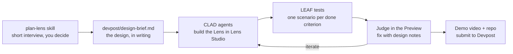

# TrafficInsight

A Lens for Snap Spectacles, built for **Learn AR with SPECS, Round 2** (Devpost, sponsored by Snap Inc.). The Lens is planned with Devpost's `plan-lens` skill, built by an AI coding agent through Snap's CLAD plugin and the Lens Studio MCP, and demonstrated in Lens Studio's Interactive Preview. No Spectacles hardware is needed.

> **Status: project setup is complete; the Lens has not been designed yet.**
> This README grows as the project does. Screenshots, a demo video and a feature walkthrough will be added once the Lens exists. Nothing below describes a feature that is not built.

## Contents

- [The hackathon](#the-hackathon)
- [How this project is built](#how-this-project-is-built)
- [Repository layout](#repository-layout)
- [Run it yourself](#run-it-yourself)
- [How the agents are configured](#how-the-agents-are-configured)
- [Troubleshooting](#troubleshooting)
- [Roadmap](#roadmap)
- [What I learned](#what-i-learned)
- [Credits and license](#credits-and-license)

## The hackathon

Learn AR with SPECS asks participants to design an augmented reality app for glasses and let a coding agent build it in Lens Studio. The design is the hard part: good AR shares your view, draws content in the world at real size, and leaves your hands free, instead of being "a website floating in front of your face".

Entries are judged on four equally weighted criteria: **Design**, **Technical Implementation**, **Innovation/Idea** and **Presentation**. The submission is a public demo video (under 3 minutes, with a screen recording of the Lens Studio preview), this repository, and a short description. Details and dates are in [docs/submission.md](docs/submission.md).

## How this project is built



1. **Plan.** The `plan-lens` skill interviews the author about the idea and checks it against AR design habits and against what the Lens Studio preview can show. The answers become a design brief in `devpost/`.
2. **Build.** CLAD (Snap's "Closed Loop Agentic Development" agents) builds the Lens from the brief, talking to Lens Studio through its built-in MCP server.
3. **Test.** LEAF (Lens Evaluation and Automation Framework) scenarios press buttons and simulate pinches in the Preview, one per done criterion in the brief.
4. **Judge and iterate.** Fixes are given as design notes ("move the card 15 cm lower"), not as code.

## Repository layout

| Path | What it is |
|---|---|
| `TrafficInsight.esproj` | The Lens Studio project file |
| `Assets/` | The Lens itself. Currently Snap's SPECS Base Template: an empty scene with the Interaction Kit rig, plus a device camera texture and render target in `Assets/Render/` |
| `Packages/` | Spectacles Interaction Kit (SIK), UI Kit, Motion and Icons, from the Base Template. Stored with Git LFS |
| `devpost/` | The planning documents written by `plan-lens` (required by the hackathon) |
| `docs/` | Everything beyond this README: [context-engineering.md](docs/context-engineering.md), [submission.md](docs/submission.md), [decision records](docs/decisions/), and `media/` for screenshots |
| `AGENTS.md`, `CLAUDE.md` | Instructions for coding agents (Lens Studio's block plus this project's rules) |
| `.claude/` | Claude Code settings and path-scoped rules |
| `skills-lock.json` | Pins the exact version of the `plan-lens` skill |
| `.gitignore`, `.gitattributes` | Lens Studio's managed blocks (what to ignore, Git LFS for large assets, LF for text) plus a small block of our own below them |

Lens Studio also creates `Cache/`, `Support/`, `Workspaces/` and `PluginsUserPreferences/` locally. They are regenerated and git-ignored.

## Run it yourself

**Requirements:** Lens Studio **5.25 or later** (Snap's CLAD, MCP and LEAF documentation requires it) and **Git LFS**. A Spectacles device is not needed.

The large files (the environment map and the four packages) are stored with Git LFS, so a plain ZIP download from GitHub will not contain them. Snap's notes for the Base Template say the same: "Clone with Git LFS; a ZIP download will not work."

1. Install Git LFS, then run `git lfs install` once. Clone the repository. If the packages show up as tiny text files, run `git lfs pull`.
2. Open `TrafficInsight.esproj` in Lens Studio.
3. Use the **Preview** panel. In Interactive Preview:
   - `W` `A` `S` `D` to move, `Q` and `E` to move down and up
   - right-drag (or hold Shift) to look around
   - a mouse click acts as a pinch
4. To work on it with a coding agent, see [How the agents are configured](#how-the-agents-are-configured).

_Unverified: these clone steps have not been tested from a fresh clone, because the repository has no remote yet._

## How the agents are configured

Three agents share this folder: Claude Code, the `plan-lens` skill and the CLAD builders. They are kept useful by giving each one only the context it needs, and by enforcing the rules that must never be broken with settings instead of requests. The full explanation, with diagrams, is in **[docs/context-engineering.md](docs/context-engineering.md)**. In short:

| Layer | Files | Purpose |
|---|---|---|
| Lens Studio's block | `AGENTS.md` (top), `CLAUDE.md` | Runtime, APIs, spatial rules. Rewritten by Lens Studio, never edited by hand |
| Project rules | `AGENTS.md` (below the END marker) | The brief is the source of truth, Preview-only, SIK and UI Kit, conventions |
| Path-scoped rules | `.claude/rules/` | Loaded only when matching files are touched |
| Skills | `skills-lock.json` | `plan-lens` pinned to an exact upstream commit |
| Guarantees | `.claude/settings.json` | No AI attribution in commits, token files unreadable to agents, confirmation before `git push` |

The reasoning behind the main choices is recorded in [docs/decisions/](docs/decisions/).

To set up your own agent in this project: open the project in Lens Studio first, start the MCP server (*AI Assistant > AI Model Context Protocol (MCP) > Configure Server*), then start your agent from the project folder. For Claude Code, install the CLAD plugin:

```text
/plugin marketplace add https://github.com/lens-studio-devs/ls-extensions.git
/plugin install ls-clad@ls-extensions
```

## Troubleshooting

Problems that came up while setting this project up on Windows 11. Most are likely to affect other participants.

**Lens Studio closes immediately after launching.** The crash dumps in `%LOCALAPPDATA%\Snap\sentry\...\reports` all showed a null-pointer crash in `MSVCP140.dll`, Microsoft's Visual C++ runtime. The cause was a stale runtime: the three files `msvcp140.dll`, `vcruntime140.dll` and `vcruntime140_1.dll` in `C:\Windows\System32` were version 14.28 while Windows reported a much newer redistributable as installed. Installing the latest 64-bit [Visual C++ Redistributable](https://aka.ms/vs/17/release/vc_redist.x64.exe) replaced them (all three then reported 14.52) and Lens Studio started normally. If the installer says a newer version is already present, choose *Repair* and restart Windows. You can check the versions with `(Get-Item C:\Windows\System32\msvcp140.dll).VersionInfo.FileVersion`.

**The *Core Chat Tools* and *Agents Docs* plugins are missing from *Preferences > Plugins*.** Lens Studio downloads its recommended plugins at startup. If it launches before the network is ready, the log shows `Error when fetching preinstalled content from asset library: Offline mode`, and it does not retry. Close Lens Studio completely and reopen it with a working connection, wait about a minute, then tick both plugins.

**The `Packages/` folder is empty and the scene has no Interaction Kit.** The project was created with Lens Studio's plain "new project" instead of *SPECS > Base Template*. The two look alike (both target Spectacles) but only the Base Template includes the Interaction Kit, UI Kit, Motion and Icons packages. Check `fromTemplateName` in the `.esproj` file: it should say `Spectacles`, not `Default`. See [decision 0005](docs/decisions/0005-start-from-the-specs-base-template.md).

**Claude cannot reach `lens-studio`.** Lens Studio must be running before the agent starts, and its port can change after a restart. In Claude Code, `/mcp` shows the connection and lets you reconnect.

**A pushed repository has tiny text files instead of assets.** Git LFS uploads the large files from a per-repository `pre-push` hook. Without it, only the pointer files are pushed. Run `git lfs install --local` in the repository before the first push, and check that `.git/hooks/pre-push` exists.

**The project folder cannot be renamed or moved ("in use" or "access denied").** A terminal opened with *File > Show Project in Terminal* keeps its folder locked, even after the program running in it has exited. Close the whole terminal window first. If it still fails, restarting Windows releases the lock.

## Roadmap

- [x] Create the Lens Studio project from the SPECS Base Template (Lens Studio 5.25.0)
- [x] Layer the agent context and document it
- [x] Pin the `plan-lens` skill
- [ ] Brainstorm the idea
- [ ] Run `plan-lens` and approve `devpost/design-brief.md`
- [ ] Build with CLAD and test with LEAF
- [ ] Judge in the Preview and iterate
- [ ] Screenshots and GIFs in `docs/media/`, then the final README
- [ ] Demo video and Devpost submission (deadline: Dec 7, 5:00 PM ET)

## What I learned

_To be written once the Lens is built._

## Credits and license

- [Lens Studio](https://ar.snap.com/lens-studio), Spectacles, CLAD, LEAF, the Lens Studio MCP server and the Spectacles Interaction Kit are by Snap Inc.
- The `plan-lens` skill and the hackathon are by Devpost.
- The Base Template, including its default scene, `Assets/Render/Echopark.hdr` and the Interaction Kit, UI Kit, Motion and Icons packages, is Snap's and remains subject to Snap's terms.
- Code in this repository is released under the [MIT License](LICENSE).
