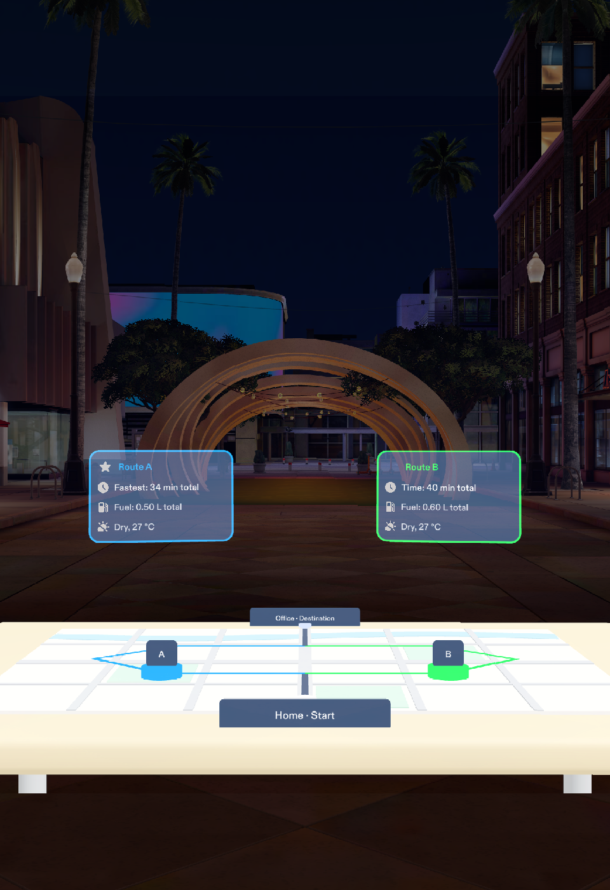
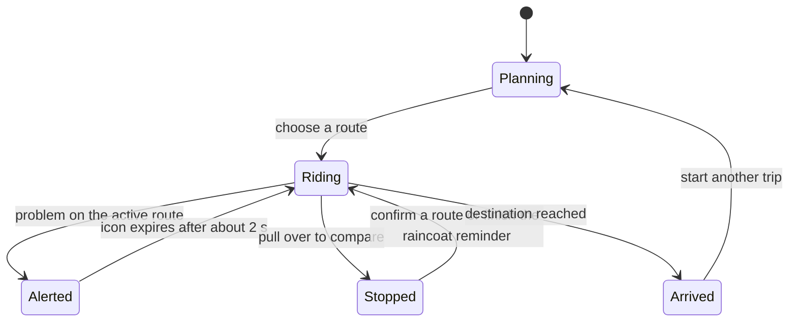
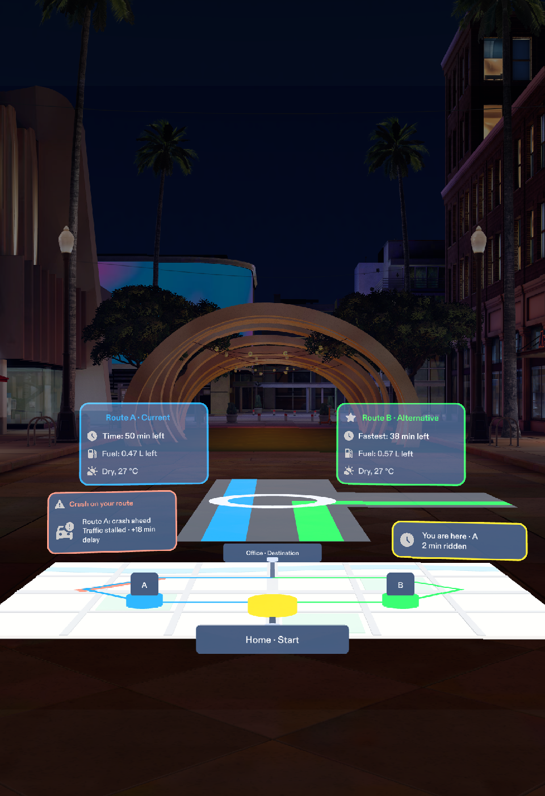
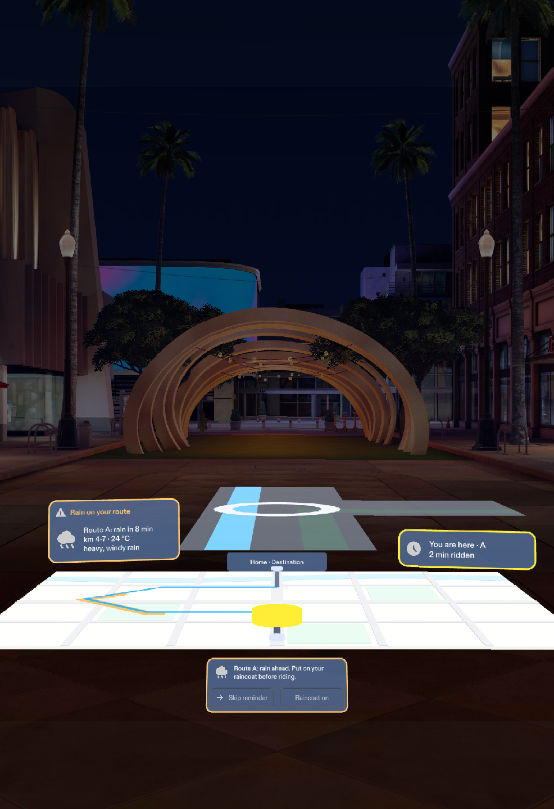
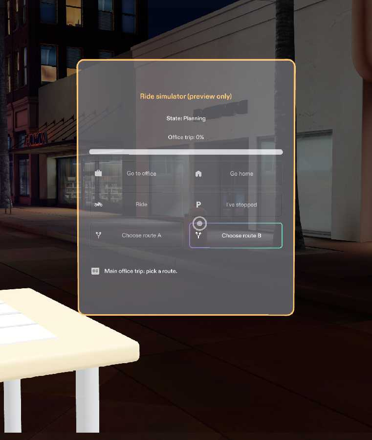
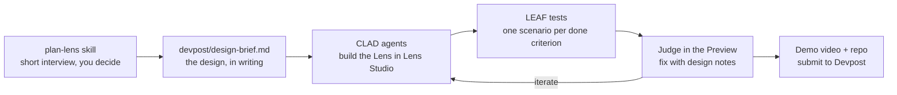
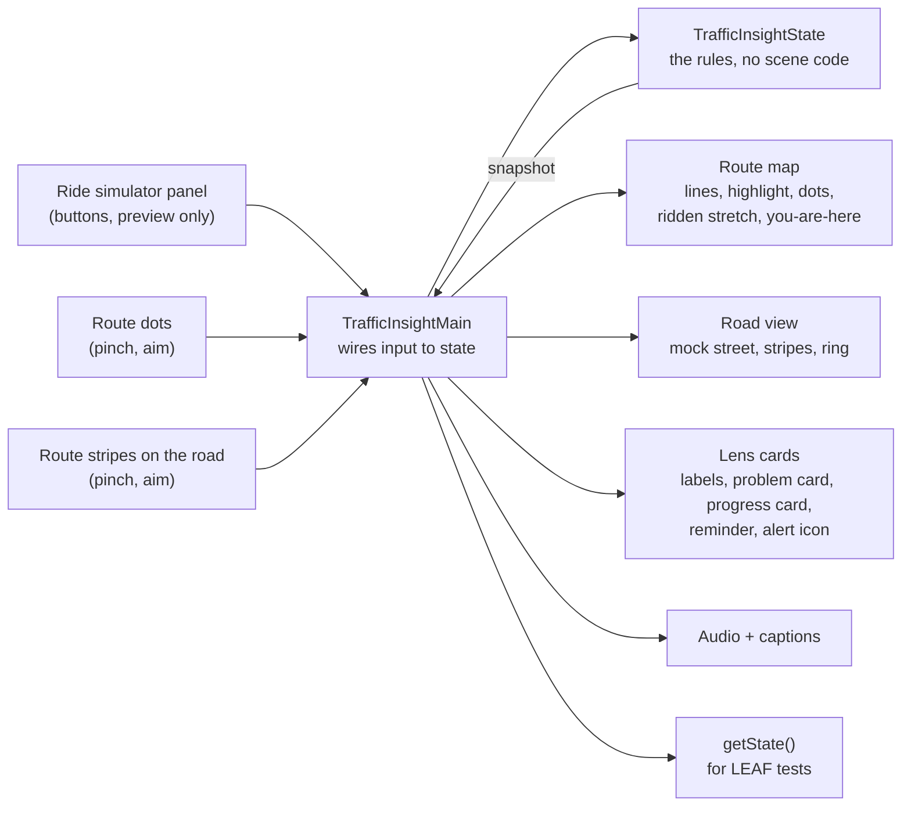

# TrafficInsight

**A commute co-pilot for motorcycle riders on Snap Spectacles.** Plan a trip in your space, receive a brief warning when your route is affected, and pull over to compare the options before continuing.



Built for **Learn AR with SPECS, Round 2**, using Lens Studio, CLAD, the Lens Studio MCP, Spectacles Interaction Kit and UI Kit.

> **Verified in Interactive Preview on 2026-11-20:** TypeScript compiles, runtime startup was checked, and LEAF C1-C9 pass after the consistency polish. C5 and C9 were also rerun after the final raincoat layout fix. The four consistency screenshots below are fresh Preview captures.
> This is a simulation: routes, movement, traffic, weather and fuel are sample data. No Spectacles hardware has been tested. The glance feature remains planned, not built; the submission video is still outstanding.

## Contents

- [What it does](#what-it-does)
- [Walkthrough](#walkthrough)
- [Tests](#tests)
- [Why it belongs on glasses](#why-it-belongs-on-glasses)
- [How this project is built](#how-this-project-is-built)
- [Design decisions made during the build](#design-decisions-made-during-the-build)
- [Known limitations](#known-limitations)
- [Repository layout](#repository-layout)
- [Run it yourself](#run-it-yourself)
- [How the agents are configured](#how-the-agents-are-configured)
- [Troubleshooting](#troubleshooting)
- [Roadmap](#roadmap)
- [The hackathon](#the-hackathon)
- [What I learned](#what-i-learned)
- [Credits and license](#credits-and-license)

## What it does

The demo follows one day in two trips:

1. **Home to office:** compare two routes, choose one, then respond to a crash on route A by pulling over and choosing again.
2. **Office to home:** respond to rain on route A by comparing the fastest rainy route with the longer dry alternative, or prepare a raincoat before continuing.

The Lens shows the full interface only while Planning or Stopped. Riding clears the table, map, labels and road marks. An affected-route alert briefly shows a small icon, with a chime and a caption on the separate simulator panel.



## Walkthrough

### Planning: where am I going, and which option is fastest?


**Go to office** asks which office, then displays the map. **Go home** opens the evening trip. The destination clarification is a fixed sample question; both office choices use the sample corridor.

The map is a **heading-up schematic**: the start is near the rider and the destination is ahead in either trip. Labels change from Home to Office to Office to Home. This is an illustrative layout, not a north-up geographic map.

A is blue and B is green on the map, cards and mock road. The dots carry their letters. Shared approach and destination roads are neutral, so neither route appears to own the rider's position before the fork.

Cards say **min total** and **L total** during planning. The recommended option has a star and **Fastest**; travel time takes priority and fuel breaks ties. In the morning the sample totals are 34 minutes / 0.50 L for A and 40 minutes / 0.60 L for B.

### Riding: keep the view clear


Choosing a route hides the Lens interface. **Ride** advances the simulator by 5% per press. Both sample hazards belong to A: choosing B allows either trip to finish without a false warning or forced stop.

On A, a warning fires at 10%, before the fork. The icon is low and off-centre and disappears after about two seconds. The rain warning is computed from the same route timing as the rain card: initially about eight minutes ahead. If the rider advances before stopping, the card's countdown decreases.

Until the simulated problem is resolved, progress is held at 14%, still before the fork. This is demo scaffolding that keeps both choices reachable, not a model of real vehicle behaviour.

### Stopped after the crash: what changed, and why reroute?



**I've stopped** opens the floating map without the table. The yellow marker and **You are here · A** card identify the rider and current route. The dim stretch records travel already completed; the card reports elapsed minutes.

Route cards now say **min left** and **L left**, measured from that same position. At the 10% stop, the sample is approximately 50 minutes remaining on A including the crash delay, versus 38 on B. A remains labelled **Current**; B is **Alternative** and **Fastest**. The coral card explains the cause: **+18 min delay** on A.

Both choices begin at the rider's shared approach. Selecting B preserves the position and time already ridden. Aim at a dot, a route button or a road stripe to brighten the corresponding stripe. Pinch a dot or stripe to select; the chosen stripe glows and the other fades for 1.2 seconds before the Lens clears again. The white ring marks the junction; yellow is reserved for the rider.

Arrival says **You've arrived.** No deadline is modelled, so the Lens does not claim the rider is on time.

### Evening: fastest through rain, or a longer dry route?


The amber card identifies rain on A, its distance interval, temperature, intensity and type. A's weather row uses the same rain-cloud symbol as the alert and problem card. Dry rows keep the dry-weather symbol.

The choice is explicit: **A is fastest, with heavy rain; B is dry and takes 12 minutes longer.** Weather does not silently override the agreed time-first ranking. The totals are 36 minutes / 0.50 L for A and 48 minutes / 0.60 L for B; the stopped cards subtract the travel already completed.

### Keeping A: prepare before riding



Selecting rainy A asks the rider to put on a raincoat **before riding**. **Skip reminder** resumes without a raincoat confirmation; **Raincoat on** confirms preparation and resumes. The same rain symbol describes the hazard throughout; an umbrella is not used as a raincoat action.

The selected road stripe remains highlighted while this question is open. The start label beneath the map hides to make room; the destination and rider card remain. Both controls fit inside the view and are checked by C5.

### Ride simulator: preview only



The panel to the rider's right is labelled **Ride simulator (preview only)**. Its buttons substitute for destination/route voice commands, GPS movement and stopping detection. Spoken sentences currently appear as captions; the chime and confirmation tones have audio tracks. It is scaffolding, not a rider-facing control panel while moving.

Sample data and the shared timing/fuel calculations live in [`TrafficInsightTripData.ts`](Assets/Scripts/TrafficInsightTripData.ts). Each shared end road is assigned four sample minutes and 0.05 L; the branch contains the remaining cost. This keeps the already-ridden cost equal when switching routes before the fork. Hazard fractions are derived from the displayed kilometre interval and map scale.

## Tests

C1-C9 were run in Preview after the consistency changes on 2026-11-20. **All passed.** C5 and C9 passed again after compacting the reminder. Scenarios use the real Interactables and inspect state and scene objects.

| ID | Verified behaviour | Result |
|---|---|---|
| C1 | Destination clarification, two route dots, explicit total estimates, Fastest reason and destination ahead | Pass |
| C2 | Ride advances progress; both trips on unaffected B reach arrival with no false alerts or Lens visuals | Pass |
| C3 | Crash warning, chime request, caption, low/off-centre icon and approximately two-second expiry | Pass |
| C4 | Reachable alternatives at one position, remaining costs, reroute without a progress jump, persistent recommendation, glow and arrival | Pass |
| C5 | Matching rain countdown, fastest/rain versus dry/+12 trade-off, home ahead, both reminder actions and every button corner inside the view | Pass |
| C6 | Table visible throughout Planning and hidden in every other state | Pass |
| C7 | Floating map about 1.1 m ahead and below eye level | Pass |
| C8 | Dim ridden stretch, larger yellow rider marker, explicit rider/route/elapsed card, hidden when riding | Pass |
| C9 | Road/map separation, usable stripe width, hover, pinch, chosen glow, other-route fade and hidden riding view | Pass |

Sound audibility, hardware hand tracking, daylight readability and real riding comfort are unverified. Logger checks still report existing SDK deprecation and renderer batching warnings; no runtime exceptions were observed during verification.

## Why it belongs on glasses

- **Hands and eyes stay on the road.** A rider's hands are on the handlebars and their eyes must stay ahead, so a phone is not an option while moving. The Lens speaks instead of showing, and only shows when the rider has stopped.
- **The routes are laid out in your space.** When stopped, the options float in front of you at a readable size, side by side, instead of on a small flat map.

## How this project is built



1. **Plan.** The `plan-lens` skill interviewed the author about the idea and checked it against AR design habits and against what the Lens Studio preview can show. The answers became the design brief in `devpost/`.
2. **Build.** CLAD (Snap's "Closed Loop Agentic Development" agents) built the Lens from the brief, talking to Lens Studio through its built-in MCP server. Each build step (planning, assets, UI, scripts, scene set-up, audits) ran as its own agent.
3. **Test.** LEAF (Lens Evaluation and Automation Framework) scenarios press the buttons in the Preview, one per done criterion.
4. **Judge and iterate.** Problems found in the Preview were fixed as design notes, for example "raise the table 15 cm so the map stays in view".

### Inside the Lens



Every press goes to one place, `TrafficInsightState`, a plain state machine with no scene code. After each change, `TrafficInsightMain` redraws everything from the state's snapshot. Nothing on screen keeps its own idea of what state the Lens is in, so a rule like "nothing from the Lens while riding" holds everywhere at once, and the tests can check it by reading one snapshot.

| Script | Role |
|---|---|
| `TrafficInsightState.ts` | The five states, every transition, and which parts are visible in each (including the table) |
| `TrafficInsightTripData.ts` | Sample routes, shared timing/fuel helpers and the Fastest rule |
| `TrafficInsightMain.ts` | Connects input to the state, redraws the views (and shows or hides the table), runs the 2 s alert timer |
| `TrafficInsightRouteMap.ts` | Builds the route lines, problem highlight, dim ridden stretch, "you are here" marker and pinchable dots at runtime |
| `TrafficInsightRoadView.ts` | Builds the mock street, the two route stripes (aimable and pinchable) and the pulsing ring at runtime |
| `TrafficInsightGeometry.ts` | The small mesh helpers the map and the road view share (ribbon, puck, ring, rectangle) |
| `TrafficInsightTrafficLensUI.ts` | The Lens layer: label cards, problem card, progress card, raincoat reminder, alert icon (UI Kit) |
| `TrafficInsightRideSimulatorUI.ts` | The demo panel (UI Kit) |
| `TrafficInsightLazyFollow.ts` | Lets the alert icon follow the head gently |
| `TrafficInsightAudioController.ts` | Plays the four sound effects |

## Design decisions made during the build

- **Reachable choices:** alerts and stops occur on the common approach, before the fork. Both route corridors have the same shared geometry; switching does not teleport the marker.
- **One meaning per visual:** blue A, green B, yellow rider, coral crash, amber rain, white junction ring, neutral shared roads. Route identity stays fixed when the recommendation changes.
- **Explain the recommendation:** Fastest names the ranking reason; Current names the rider's actual route. The dry evening option explicitly says +12 min.
- **One scope per estimate:** totals before departure, remaining time/fuel after stopping, elapsed travel on the rider card. Rain notifications and cards share the same countdown calculation.
- **Heading-up schematic:** both sample journeys show origin near the rider and destination ahead. This does not imply real road registration or geographic accuracy.
- **Readable additive-display panels:** slate Lens cards, warm-grey simulator, light text and saturated route accents. Labels identify endpoints and route dots.
- **Confirmation before moving:** a 1.2-second route glow; hand input is gated during alert/confirmation. Raincoat preparation keeps the rider stopped.
- **Reminder stays in view:** a compact panel below the map, with no redundant start label beneath it; C5 checks projected button corners.

The reasoning and validation are recorded in [decision 0006](docs/decisions/0006-consistent-route-story.md).

## Known limitations

- **Riding with AR glasses is unproven.** No study of AR glasses on motorcycles was found, and there is no Snap guidance about vehicles. The three-state design follows car and helmet head-up display research; whether it is safe on a real bike can only be found out by real-world testing.
- **No spoken voice.** The Lens plays its chime and tones, but the text-to-speech module is deprecated in this SDK, so the spoken lines appear as captions on the simulator panel instead. The brief planned captions as the fallback for exactly this case.
- **Preview only.** Hand tracking, comfort over time and readability in daylight are untested on real Spectacles.
- **The road view and map are schematic stand-ins.** It is a model of a street in the Preview room. How accurately a route line would sit on a real road, and how it would look in daylight, is untested.
- **Tooling left in the scene.** The scene contains an `AiPreviewAgent Handler` object, added by the Lens Studio preview tools the agent used. It renders nothing and may be removed before submission.

## Repository layout

| Path | What it is |
|---|---|
| `TrafficInsight.esproj` | The Lens Studio project file |
| `Assets/Scripts/` | The Lens's TypeScript components (see [Inside the Lens](#inside-the-lens)) |
| `Assets/Tests/` | LEAF scenarios C1 to C9 and their shared driver |
| `Assets/GeneratedMeshes/`, `Assets/GeneratedSFX/` | The table and city map models and the four sound effects, all made in code (no third-party assets) |
| `Assets/Icons/`, `Assets/Materials/` | Material icons and the route line material |
| `Packages/` | Spectacles Interaction Kit (SIK), UI Kit, Motion and Icons from the Base Template; LEAF; and the Lens Studio preview-agent helpers. Stored with Git LFS |
| `tools/asset-generators/` | The scripts that made the models (Blender) and sounds (Node.js) |
| `devpost/` | The planning documents written by `plan-lens` (required by the hackathon) |
| `docs/` | Everything beyond this README: [context-engineering.md](docs/context-engineering.md), [submission.md](docs/submission.md), [decision records](docs/decisions/), [plans](docs/plans/) for work agreed but not built yet, and `media/` for screenshots |
| `AGENTS.md`, `CLAUDE.md` | Instructions for coding agents (Lens Studio's block plus this project's rules) |
| `.claude/` | Claude Code settings and path-scoped rules |
| `skills-lock.json` | Pins the exact version of the `plan-lens` skill |
| `.gitignore`, `.gitattributes` | Lens Studio's managed blocks (what to ignore, Git LFS for large assets, LF for text) plus a small block of our own below them |

Lens Studio also creates `Cache/`, `Support/`, `Workspaces/` and `PluginsUserPreferences/` locally, and the build tools create `.clad/`, `.virtual-scene.json` and `Plugins/`. All are regenerated and git-ignored.

## Run it yourself

**Requirements:** Lens Studio **5.25 or later** (Snap's CLAD, MCP and LEAF documentation requires it) and **Git LFS**. A Spectacles device is not needed.

The large files (the environment map, the packages and the generated assets) are stored with Git LFS, so a plain ZIP download from GitHub will not contain them. Snap's notes for the Base Template say the same: "Clone with Git LFS; a ZIP download will not work."

1. Install Git LFS, then run `git lfs install` once. Clone the repository. If the packages show up as tiny text files, run `git lfs pull`.
2. Open `TrafficInsight.esproj` in Lens Studio.
3. Use the **Preview** panel. In Interactive Preview:
   - `W` `A` `S` `D` to move, `Q` and `E` to move down and up
   - right-drag (or hold Shift) to look around
   - a mouse click acts as a pinch
4. Turn right to find the Ride simulator. Press **Go to office**, answer the question, look back at the table and click a route dot. Then press **Ride** a few times.
5. To work on it with a coding agent, see [How the agents are configured](#how-the-agents-are-configured).

_Unverified: these clone steps have not been tested from a fresh clone, because the repository has no remote yet._

## How the agents are configured

Three agents share this folder: Claude Code, the `plan-lens` skill and the CLAD builders. They are kept useful by giving each one only the context it needs, and by enforcing the rules that must never be broken with settings instead of requests. The full explanation, with diagrams, is in **[docs/context-engineering.md](docs/context-engineering.md)**. In short:

| Layer | Files | Purpose |
|---|---|---|
| Lens Studio's block | `AGENTS.md` (top), `CLAUDE.md` | Runtime, APIs, spatial rules. Rewritten by Lens Studio, never edited by hand |
| Project rules | `AGENTS.md` (below the END marker) | The brief is the source of truth, Preview-only, SIK and UI Kit, conventions |
| Path-scoped rules | `.claude/rules/` | Loaded only when matching files are touched |
| Skills | `skills-lock.json` | `plan-lens` pinned to an exact upstream commit |
| Guarantees | `.claude/settings.json` | No AI attribution in commits, token files unreadable to agents, confirmation before `git push` |

The reasoning behind the main choices is recorded in [docs/decisions/](docs/decisions/).

To set up your own agent in this project: open the project in Lens Studio first, start the MCP server (*AI Assistant > AI Model Context Protocol (MCP) > Configure Server*), then start your agent from the project folder. For Claude Code, install the CLAD plugin:

```text
/plugin marketplace add https://github.com/lens-studio-devs/ls-extensions.git
/plugin install ls-clad@ls-extensions
```

## Troubleshooting

Problems that came up while setting up and building this project on Windows 11. Most are likely to affect other participants.

**Lens Studio closes immediately after launching.** The crash dumps in `%LOCALAPPDATA%\Snap\sentry\...\reports` all showed a null-pointer crash in `MSVCP140.dll`, Microsoft's Visual C++ runtime. The cause was a stale runtime: the three files `msvcp140.dll`, `vcruntime140.dll` and `vcruntime140_1.dll` in `C:\Windows\System32` were version 14.28 while Windows reported a much newer redistributable as installed. Installing the latest 64-bit [Visual C++ Redistributable](https://aka.ms/vs/17/release/vc_redist.x64.exe) replaced them (all three then reported 14.52) and Lens Studio started normally. If the installer says a newer version is already present, choose *Repair* and restart Windows. You can check the versions with `(Get-Item C:\Windows\System32\msvcp140.dll).VersionInfo.FileVersion`.

**The *Core Chat Tools* and *Agents Docs* plugins are missing from *Preferences > Plugins*.** Lens Studio downloads its recommended plugins at startup. If it launches before the network is ready, the log shows `Error when fetching preinstalled content from asset library: Offline mode`, and it does not retry. Close Lens Studio completely and reopen it with a working connection, wait about a minute, then tick both plugins.

**The `Packages/` folder is empty and the scene has no Interaction Kit.** The project was created with Lens Studio's plain "new project" instead of *SPECS > Base Template*. The two look alike (both target Spectacles) but only the Base Template includes the Interaction Kit, UI Kit, Motion and Icons packages. Check `fromTemplateName` in the `.esproj` file: it should say `Spectacles`, not `Default`. See [decision 0005](docs/decisions/0005-start-from-the-specs-base-template.md).

**Claude cannot reach `lens-studio`.** Lens Studio must be running before the agent starts, and its port can change after a restart. In Claude Code, `/mcp` shows the connection and lets you reconnect.

**A pushed repository has tiny text files instead of assets.** Git LFS uploads the large files from a per-repository `pre-push` hook. Without it, only the pointer files are pushed. Run `git lfs install --local` in the repository before the first push, and check that `.git/hooks/pre-push` exists.

**The project folder cannot be renamed or moved ("in use" or "access denied").** A terminal opened with *File > Show Project in Terminal* keeps its folder locked, even after the program running in it has exited. Close the whole terminal window first. If it still fails, restarting Windows releases the lock.

**An agent driving the Preview presses a button it did not aim at.** When the MCP preview tool pinches a button with the simulated right hand, the hand can brush a neighbouring button as it pulls back, which registers as a second press (seen with **Go home** next to **Go to office**, and with **Ride**). Using the left hand with short, isolated pinches reduces it; LEAF provides the reproducible checks. Mouse clicks and LEAF's own input are not affected.

## Roadmap

- [x] Create the Lens Studio project from the SPECS Base Template (Lens Studio 5.25.0)
- [x] Layer the agent context and document it
- [x] Pin the `plan-lens` skill
- [x] Brainstorm the idea
- [x] Run `plan-lens` and approve `devpost/design-brief.md`
- [x] Build with CLAD and test with LEAF (C1 to C5 passed at the first build)
- [x] Screenshots in `docs/media/` and the feature walkthrough
- [x] Revision 1, part 1: the table shows only while planning, and the map floats when stopped (C6)
- [x] Revision 1, part 2: progress along the path (the ridden part dim, a "you are here" marker, a progress card) (C8, with the map placement check C7)
- [x] Revision 1, part 3: the route marked on the road ahead (a mock street with pinchable route lines) (C9; C1 to C9 pass)
- [x] Consistency polish: route reachability, timing, ranking explanation, map labels, unified symbols and reminder layout (C1-C9 pass)
- [ ] Planned: a brief glance at the route while riding, by looking down or asking "where am I?" (plan: [docs/plans/glance-while-riding.md](docs/plans/glance-while-riding.md))
- [ ] Demo video and Devpost submission (deadline: Dec 7, 5:00 PM ET)

## The hackathon

Learn AR with SPECS asks participants to design an augmented reality app for glasses and let a coding agent build it in Lens Studio. The design is the hard part: good AR shares your view, draws content in the world at real size, and leaves your hands free, instead of being "a website floating in front of your face".

Entries are judged on four equally weighted criteria: **Design**, **Technical Implementation**, **Innovation/Idea** and **Presentation**. The submission is a public demo video (under 3 minutes, with a screen recording of the Lens Studio preview), this repository, and a short description. Details and dates are in [docs/submission.md](docs/submission.md).

## What I learned

_To be written._

## Credits and license

- [Lens Studio](https://ar.snap.com/lens-studio), Spectacles, CLAD, LEAF, the Lens Studio MCP server, the Spectacles Interaction Kit and UI Kit are by Snap Inc.
- The `plan-lens` skill and the hackathon are by Devpost.
- The Base Template, including its default scene, `Assets/Render/Echopark.hdr` and the Interaction Kit, UI Kit, Motion and Icons packages, is Snap's and remains subject to Snap's terms.
- Icons are [Material Symbols](https://fonts.google.com/icons) by Google (Apache License 2.0), imported through Snap's Icons package.
- `Assets/Tests/TrafficInsightLeafDriver.ts` adapts the "Custom Interactor Template" from Snap's LEAF package.
- The table and city map models and the sound effects were generated by code written for this project (`tools/asset-generators/`) and use no third-party assets.
- Code in this repository is released under the [MIT License](LICENSE).
