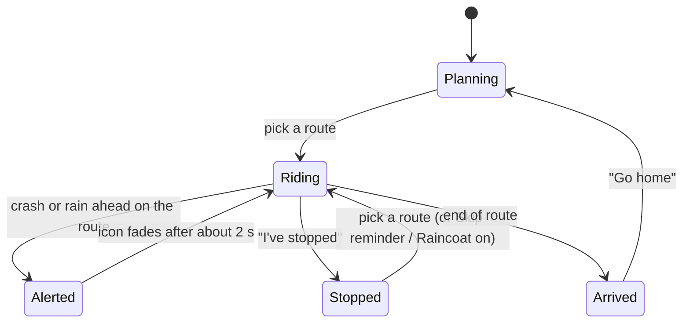

# Design brief: TrafficInsight

<!-- Filled in by plan-lens from the learner's interview. Use the learner's words. Mark any value they didn't choose as (default). -->

## The one spatial moment
I'm riding my motorcycle to the office on route A. A chime plays and a short voice says a crash ahead has stalled traffic and to pull over to see options. I pull over. There is no table at the roadside, so the full map appears floating in front of me, and the routes light up on the road ahead with a mark where they split. The map shows the rest of my route with the crash stretch highlighted, and route B beside it, both compared by time, fuel and weather, with the part I've already ridden shown dim and a clear "you are here" marker. I pinch route B, a voice says the new route is set, the map and the road marks go away, and I ride on and arrive at the office.

The demo tells this as one day, in two trips that reuse the same map, alert and stop:
1. **Morning, at home:** the map on the table shows the trip to the office with time, fuel and the other important info. I pick a route.
2. **On the road:** nothing on screen, and no table. Then the crash alert, pull over, the map floats in front of me and the routes show on the road ahead, reroute, arrive.
3. **Evening, going home:** I see the route again and ride. A rain alert comes before the rain zone. I pull over, see where the rain is and how bad it is, and either take the dry reroute or stay on my route and put on my raincoat. I ride through the rain prepared, and that's the happy part: being warned in time.

## Why it belongs on glasses
- Uses: leaves your body free, draws in the world.
- Why it's better than the phone or laptop version: while riding, my hands are on the handlebars and my eyes must stay on the road, so I can't use a phone. And I want to see the routes laid out in my space, not on a small flat map.

## Product or overlay
- Type: overlay. It responds to the real road, real traffic and real weather on my commute.
- What the real version would sense: my location and speed (GPS), whether I've stopped, live traffic and incidents (crashes), live weather along the route, and my voice ("office", "route B").
- Stand-in for the preview: see the table below. The rule the learner set: we know what the product should be. Anything the preview can't do becomes a button or another simple input, and the README and video say so truthfully.

| Real product | Preview stand-in |
|---|---|
| I say "office", or use a saved shortcut | A "Go to office" button (morning) and a "Go home" button (evening) |
| If my destination is unclear, it asks which one I mean | One hard-coded clarifying question, "Which office: Main office or Branch office?", with a button for each (default wording) |
| GPS follows me along the road | A **Ride simulator** panel: a button moves my position along the route (default) |
| The Lens detects that I've pulled over | An "I've stopped" button on the Ride simulator panel |
| Live traffic and crash reports | Hard-coded: a crash on morning route A that adds +18 min (default number) |
| Live weather along the route | Hard-coded: rain on evening route A between km 4 and 7, 24 °C, heavy, "windy rain" (temperature, intensity and type are defaults) |
| Typical route time and fuel | Labeled sample times by default, or collected weekday motorcycle time estimates for the Barcelona main office. Fuel uses the two sample routes. |
| Choosing a route by voice ("route B") | A button for every voice command, next to the pinch dots |
| The map lies flat on a real table or wall, or floats about 1 m in front of me if there's no flat surface | A virtual table in the room for the planning view at home. At the roadside the map simply floats about 1 m in front of me, with no table |
| The route drawn on the real road ahead (the real version needs my location and heading) | A mock street in the room with the route lines laid on it, shown only when I've stopped |
| Looking down at the dashboard spot while riding | Tilt the Interactive Preview camera down with right-drag; return it level to re-arm |
| Saying "where am I?" | "Where am I?" button on the separate Ride simulator, with a caption fallback |
| Spoken alerts and confirmations | Spoken audio if it works in the preview. The same sentence also shows as a caption on the Ride simulator panel, so the demo never depends on it (default) |

**Two layers in the scene.** The *Lens* is what the rider would see on real glasses. The *Ride simulator* is demo scaffolding that only exists because the preview has no road. Keep them clearly separate: the simulator panel sits off to one side, labeled "Ride simulator (preview only)" (default). The clear-riding-view rule applies to the Lens layer only, with the explicitly requested glance strip as its sole riding exception. The mock street stands in for the real road and exists only in the preview; the Lens's route lines and marks are drawn on it, and only while I'm stopped.

## Where things live
- Where the user is looking during the main task: in the stopped state, at the floating map in front of them, a little below eye level. While riding, straight ahead at the road.
- **Route map (planning):** flat on a virtual table, about 60 × 40 cm (default), table top about 75 cm high (default), about 1 m in front of the user's start position (default) and a little below eye level. A simple, light-colored city map: roads as thin light lines, routes as thicker colored lines raised slightly off the map. No dark backgrounds, because black renders as transparent.
- **Route dots:** one big dot per route, about 4 cm across (default). Each sits on its own route line where the routes are furthest apart (default).
- **Route labels:** a small card next to each dot showing that route's time, fuel and weather. The recommended route (best time first, then fuel) is marked "Fastest".
- **Problem stretch highlight:** the crashed or rainy part of the remaining route gets a border or glow along the line.
- **Problem card:** sits on the highlighted stretch. Crash: "Crash, traffic stalled, +18 min" (default wording). Rain: temperature, rain intensity, and type (storm, windy rain, light rain).
- **Raincoat reminder:** a small panel just below the map, centred in front of the rider (default), with "Skip reminder" and "Raincoat on" buttons. It sits below the map so it never covers the street ahead or the map.
- **Alert icon:** small, about 4 cm (default), low in the view and never in the center, about 1 m away (default). It gently follows where the user looks so it stays in view (default).
- **Ride simulator panel:** to the user's right, about 1 m away, angled toward them (default). It holds a route progress bar, the "Ride" button, the "I've stopped" button, the trip buttons, the voice-command buttons and the caption line.
- **Floating map (stopped):** the same map, dots, labels and cards, with no table. About 1.1 m in front of the rider (default) and about 20 cm below eye level (default), facing the rider. It stays still once it appears.
- **Progress marks (stopped):** the part of the route already ridden is drawn dim. A clear "you are here" marker, larger than the home and office markers and in a bright accent colour (default). A small progress card, for example "You are here · A / 2 min ridden" (default wording, numbers from the sample data).
- **Route on the road (stopped):** a mock street on the floor of the room a few metres ahead (default: straight, about 3 m wide, about 10 m long, one junction where route B turns off). Both route lines lie on it as wide stripes (default about 40 cm, so each is at least about 2 degrees wide from where I stand, which makes it easy to aim at) in vivid, saturated colours that stand out on the muted street (default). A pulsing ring marks where the routes split (default). The street, the lines and the floating map are all in view at the same time and must not cover each other; adjust their positions in the preview until they don't.

- **Route peek (riding, requested):** a compact slate UI Kit map about 24 x 18 cm, about 1 m from the eye and 25 degrees below the horizon. Show the active route's actual sample polyline, dim ridden path, yellow rider marker, known problem interval and Home/Office endpoints. Keep minutes left and the next problem below it. Hold the map heading while viewing it so looking aside leaves its direction. The map itself has no hand targets; Hide route is a simulator control.

## Hands and input
- Choose destination: pinch "Go to office" or "Go home" (stand-ins for voice or a saved shortcut). If the destination is unclear, pinch the answer to the clarifying question.
- Choose a route: pinch the route's dot, or, when I'm stopped, pinch the route's line on the road ahead. Dragging isn't needed. The route lines react: when I aim at a dot, a "Choose route" button or the line itself, that route's line brightens, and when I pick one, its line glows and the other fades.
- Raincoat reminder: pinch "Skip reminder" or "Raincoat on".
- Simulate the ride: pinch "Ride" on the Ride simulator to move along the route, and "I've stopped" to pull over.
- Targets are big and highlight when aimed at.
- Voice and the button that does the same job: "office" or "home" = the trip buttons; "route A" or "route B" = a "Choose route A" or "Choose route B" button on the simulator panel, plus the dots themselves; "skip reminder" or "raincoat on" = the reminder buttons.
- Route peek: look down 20-40 degrees for 0.3 s while Riding, within 15 degrees horizontally of the map. It stays visible without a time limit while the view remains within the wider hold zone (12-45 degrees down, 22 degrees sideways). Looking straight, too far down or aside hides it; looking back into its direction reopens it after the dwell. Hide route explicitly dismisses it; look level within 8 degrees for 0.5 s to re-arm after an explicit dismissal, voice request or state interruption. This uses head/camera direction, not eye tracking.
- "Where am I?" reports minutes left and the next known problem by voice/caption only, dismissing any active route peek. Outside Riding it gives "Ask while riding."; during Alerted it is ignored so the warning wins.
- Alerted state: no hand input, voice only (learner's safety rule).

## When things show
Three states, for safety:

- **Planning (at home or at the office):** the virtual table is visible for the whole planning state, including at the start and while the clarifying question is shown, and once the destination is clear the map shows the whole trip on it, with route dots and labels. The table and map hide once a route is picked.
- **Riding:** the Lens is clear by default (no full planning/stopped map, table or road marks). A deliberate look into the route-peek direction reveals only the compact route map for as long as the user holds that angle. Looking away or using Hide route dismisses it. Short voice cues and the requested Where am I? answer use captions as the existing fallback. An alert, stop or arrival dismisses the map immediately.
- **Alerted:** a chime plus one short sentence, and the small icon low in the view, which disappears after about 2 seconds. Morning: "Crash ahead on your route, traffic is stalled. Pull over to see options." (default wording). Evening: "Rain on your route in N minutes. Pull over to see options." N is computed from the route timing (initially 8 in the current sample). Keep the tone calm (default).
- **Stopped:** the full picture. There is no table: the map floats in front of the rider, with the progress marks, the rest of the route with the problem stretch highlighted, the problem card, and a dot and label for each option. The routes are also laid on the mock street ahead, with a pulsing ring where they split. Morning: current route A and reroute B. Evening: the dry reroute (when available; in the sample data it is, at +12 min, a default number) and the rainy route.
- **After choosing:** a voice says "New route set" (default wording). The chosen route's line on the road glows and the other one fades for about a second (default, hand input is off during it), then the map and the road marks hide, so you're back to riding.
- **Raincoat reminder:** shows only if the rainy route is chosen. Hides when "Skip reminder" or "Raincoat on" is pinched, and everything goes back to normal riding.
- **Arrived:** a short voice line, "You've arrived." (default wording). Nothing stays on screen.
- If something needs attention out of view: the chime and voice do that job; the map only appears when the rider has stopped.

## Done criteria
Each one can be checked in Lens Studio's preview. Updated for the approved consistency polish; each criterion keeps its existing LEAF ID.
1. Pressing "Go to office" shows the map on the virtual table with two routes. Each has a big dot and a label with time, fuel and weather, and one is marked "Fastest". Pinching a dot picks that route and the map hides.
2. While riding, pressing "Ride" moves the progress bar on the Ride simulator, and nothing from the Lens is in view, including the table, until an alert or a deliberate look-down glance.
3. At the crash point a chime plays, the alert sentence plays (and shows as a caption), and a small icon appears low in the view, not in the center, then disappears after about 2 seconds.
4. Pressing "I've stopped" after the crash alert shows the map floating in front of me (no table), with the rest of route A and the crash stretch highlighted, a delay card, plus route B. Pinching route B's dot plays "New route set", its line glows for about a second, and then the map hides, and riding on to the end plays the arrival confirmation.
5. On the evening trip, after the rain alert, pressing "I've stopped" shows the rainy stretch highlighted with a card for temperature, rain intensity and type. Pinching the rainy route's dot shows the raincoat reminder, and pinching "Skip reminder" or "Raincoat on" hides it and returns to riding.
6. The virtual table is visible during the whole planning state, including at the start and while the clarifying question is shown, and is hidden in every other state.
7. Pressing "I've stopped" puts the map about 1 m ahead and a little below eye level, in view.
8. When stopped, the part of the route already ridden is shown dim, with a clear "you are here" marker and a progress card, for example "You are here · A / 2 min ridden".
9. When stopped, both routes are also shown laid on the mock street ahead, in vivid colours, with a pulsing ring where they split, and the street and the map do not cover each other. Aiming at a route's dot or at its line brightens that line. Pinching a route's line chooses that route, the same as pinching its dot. Choosing a route makes its line glow and fades the other: for about a second before riding starts, or for as long as the raincoat question is open. Riding hides all of it.

10. Preview-only surroundings follow the journey without resetting it: home while planning the morning trip (including clarification), a daytime street while riding/alerted/stopped, then the office on arrival. Planning the return starts at the office in the evening, uses an evening street, and ends at home. Known route-A rain appears ahead before the rain zone and around the rider within it; taking dry B clears that rain context. Scenery has no interactions, stays separate from the Lens layer, and is never built on real glasses.

11. While Riding, looking into the dashboard direction for about 0.3 s shows a compact route map using the same bent polyline as the planning view, with endpoint labels, a dim ridden path, yellow rider position, known problem interval, minutes left and next problem. The marker follows both coordinates of that path as progress advances. The anchor stays about 25 degrees below the horizon as head pitch changes.
12. The route map has no duration cap while the user holds the viewing angle. Looking straight or away horizontally/vertically hides it; looking back reopens it after the dwell. Hide route on the simulator dismisses it immediately without changing the trip or progress, and it stays dismissed until a fresh level look. Alerts and other state interruptions also require a fresh level look.
13. Pressing "Where am I?" while Riding gives the minutes left and next known problem as a caption/optional spoken line, using the same facts as the route map. It shows no Lens visuals and dismisses any active peek. It does not change route, progress or trip state.
14. No route peek appears in Planning, Alerted, Stopped or Arrived. An alert cancels a route peek immediately and shows its own icon. Returning to Riding while still looking down cannot reopen the route peek; looking level re-arms it.

## Route peek refinement (approved 2026-11-20)

The author requested a route-shaped overview instead of a straight progress
strip, and removed the two-second duration cap. Reuse the sample trip geometry
and shared remaining-cost/problem helpers. Unknown hazards are not disclosed.
Hold the map heading during viewing so a sideways look actually leaves it.
Use head/camera direction, with pitch/yaw hysteresis, not eye tracking.
Natural look-away allows looking back; explicit dismissal and alerts require
a fresh level look to prevent immediate reopening. Hide route is a simulator
control, never a route-choice gesture. This does not add live GPS, geographic
map data or a route overlay on the real road. C11-C14 retain their IDs with
updated map/visibility criteria. This supersedes the straight-strip/two-second
rules in the original revision-two plan and decision 0008.

## Departure planning (approved 2026-11-24)

15. After a destination is chosen, show a departure card on the planning map. In a good window recommend the quickest current route. During a busy window show a lighter departure and the quickest choice if leaving now, including A when B offers no improvement. Compare ride times and arrival clocks. Let the rider leave on either route in one pinch. Suppress timing advice for sparse history. Hide the card during the ride and use the chosen estimate for the route peek, caption and stopped comparison. LEAF C15 exercises the labeled sample scenarios through the normal controls.

The Now view uses a recent paired route sample when it is at most 20 minutes old. Label the historical fallback when fresh traffic is unavailable. Show the graph on request from the Now card. Hiding it restores current departure advice, and reopening it restores the last viewed weekday for this plan. Let the rider select any weekday and compare both routes on a graph of typical trip minutes by Barcelona departure time. Keep both axes fixed across weekdays for the chosen trip direction. Show gaps where the history lacks enough observations. Browsing a weekday keeps the route choices tied to leaving now. LEAF C15 verifies that separation.

An independent collector samples each Barcelona corridor and direction every 15 minutes. Use weekday and local time to compare departures within the coming hour. At least three distinct matching dates support each estimate. The main-office commute connects Nou Barris and Zona Franca. The branch office uses its own fallback. [Collector and route details](../tools/traffic-history/README.md)

## Preview context (approved 2026-11-20)

The background explains the current trip stage. Use one Preview setup with
lightweight home, street and office scenery, showing only the relevant place
from the same journey snapshot as the UI. Planning and arrival identify the
correct origin/destination for each trip; Alerted and Stopped keep the street.
Day/evening and known rain provide context without adding riding controls.
This is demo scenery, not GPS, real weather or a replacement for the real
surroundings on glasses. The editor-only guard must run before building any
scenery. Keep the existing map and controls readable and the journey's state,
progress and route intact during a place change. LEAF C10 checks this flow.

### Surface realism (approved polish, 2026-11-22)

Refine C10 with photographic asphalt, masonry and wood textures, PBR shading,
rounded furniture and architectural detail, and a photographic sky. Inspect
the street and UI readability first, then apply the treatment to home and
office. Preserve trip-stage/weather meaning, the editor-only guard, current
controls and progress. Keep route colours distinct from the muted scenery.
This remains a staged 3D Preview, subject to additive-display limitations;
it does not promise photorealism or geographic accuracy. Record asset sources
and licenses and keep commits focused.

## Consistency rules (approved polish, 2026-11-20)

These refine the original nine criteria. The approved glance exception is specified separately above.

- The overview is a heading-up schematic: labelled Start near the rider and Destination ahead in either trip. The Preview corridors are illustrative, not reversed geographic road data.
- Blue A and green B identify the same choice across dots, labels and road stripes. Shared roads are neutral, yellow identifies the rider, and the junction ring is white.
- Stop before the fork so both choices begin at the rider's actual position. The warning is at 10%, and unresolved simulator progress is capped at 14%, before the split. Picking B preserves position, elapsed cost and progress.
- Only a hazard on the active route triggers an alert. B completes either sample trip without A's warning.
- Planning cards report total time/fuel; stopped cards report remaining time/fuel. The rider card identifies the current route and elapsed minutes. Shared-end costs are equal across the two choices.
- The recommendation is marked Fastest (time first, fuel second). Current and Alternative are separate labels. At the default evening sample time rainy A is fastest and dry B costs 12 minutes more. The comparison uses the selected departure time.
- Hazard placement, kilometre labels and countdowns agree. The warning and rain card use the same timing helper; the card counts down if the rider advances before stopping.
- Rain-cloud imagery consistently means rain. The preparation prompt says to put on a raincoat before riding; Skip reminder resumes without confirming preparation.
- The compact reminder is below the map with both actions fully visible. While it is open, hide the start label below the map; keep the destination and rider card. C5 checks button corners in screen space.
- Arrival says You've arrived. No arrival deadline is simulated.

## Out of scope
- Real GPS, turn guidance, live incident alerts and live weather. The crash and rain events are scripted.
- Turn-by-turn directions while riding.
- Detecting a real table or wall. The preview uses a virtual table for planning, and the map simply floats when I'm stopped.
- Showing the route on the real road. The mock street is a stand-in; real location, heading and how well a line would sit on the right lane are untested.
- Any route overlay on the road during the ride. The compact, requested route peek is the only approved riding visual exception.
- Relying on voice recognition (every voice command has a button).
- Editing saved shortcuts.
- Mood music. (Calm wording in the alert voice is in scope.)
- Separate modes for cars or bicycles.

## Risks and open questions
- **Do not use this while operating a vehicle.** Snap's current [Spectacles best practices](https://support.spectacles.com/hc/en-us/articles/30214013362452-Best-Practices) explicitly advise against using Spectacles while driving any vehicle. This corrects the earlier claim that Snap had no vehicle guidance. This remains a Preview design concept, not a product approved for real motorcycle use.
- **Two trips is a lot to build.** Both reuse the same map, alert and stop, so the evening trip should be mostly new sample data. Build the morning trip end to end first.
- **Spoken audio may not work in the preview.** Captions on the simulator panel are the fallback.
- **Viewers may confuse the demo rig with the Lens.** Keep the Ride simulator clearly labeled and to the side.
- **The alert icon follows the view.** Content that sticks to the face is usually avoided. It's kept here because it's tiny, low and gone in 2 seconds. How it feels while moving is unproven.
- **A floating map at the roadside is unproven on a real bike.** The research found no study of AR glasses on two-wheelers. The map appears only after I've stopped and hides as soon as I ride on.
- **The road view is a stand-in.** How accurately a route line would sit on the real road is untested. The README and the video must say so.
- **The map and the road view could cover each other.** Both are shown when stopped, so check their positions in the preview.
- **Pinching a line several metres away is untested.** Aiming at a long, thin target from a distance can be fiddly. If it proves unreliable in the preview, the dots and the "Choose route" buttons remain the dependable way to choose, and the line stays highlight-only.

## Build notes for CLAD
- Build for SPECS so it runs and can be demonstrated in Lens Studio's preview. No SPECS device is available.
- Use Spectacles Interaction Kit (SIK) and UI Kit for all interactions, so they work with the mouse in Interactive Preview and with LEAF.
- Build any stand-in exactly as described above, and keep it obvious in the scene.
- Use real-world scale in centimeters. Keep content inside the user's view during the main task.
- Use vivid, saturated colours for the route lines and marks, because the display is additive and bright colours read best. Keep the mock street itself muted so the lines stand out.
- Show or hide the table, the floating map, the progress marks and the road view from the state machine's snapshot, like everything else, so the tests can check them.
- The route lines on the road are targetable (collider and Interactable) only while the Stopped state shows them, the same way the route dots are gated. Picking a line calls the same choose-route intent as the dots.
- The display is additive: black renders as transparent. Don't rely on black or very dark content to be seen; keep text light and readable from where the user stands.
- Get the basic flow working first, then add detail.
- Write LEAF scenarios for each done criterion, run them in preview, and report which pass. Say which criteria have no test.
- Don't record, identify, or follow people.

## After the build: judge it
This part is for you, after CLAD finishes.

1. **Does it work?** Ask your agent which LEAF tests passed and which done criteria have no test.
2. **Walk around it.** Open the preview in Interactive Preview. Use WASD to move, Q and E to go down and up, and right-drag (or hold Shift) to look around. Clicking acts as a pinch. Stand where a user would and look at the task.
3. **Ask the three questions.**
   - Does it use what I'm looking at?
   - Does it put something in my space, where it belongs?
   - Does it free my hands or let me keep my eyes up?
   - Would it be just as good on a phone? If so, what would make it need the glasses?
4. **Check comfort.**
   - Everything I need is in view while I do the task. Nothing sits at the edges, behind me, or stuck to my face.
   - Every control is within reach of someone standing there.
   - Text reads easily from where I stand. No dark UI disappearing.
   - Things show when needed and get out of the way.
5. **Label what you know.** Write "logic proven" next to anything the tests and preview show working, and "feel unproven" next to anything only real glasses could tell you (comfort over time, real hand tracking, real recognition).
6. **Fix with design notes, not code.** Tell your agent what to change in design terms, for example: "Move the step card 15 cm lower and next to the pan. Make the Next button twice as big. Re-run the tests." If a fix takes under a minute, like nudging a panel, do it yourself in the scene.
7. **Submit.** Record a video under 3 minutes of your Lens in the preview, public on YouTube. Make your repo public with your Lens Studio project and this `devpost/` folder. Details are on the hackathon site: https://learn-specs.devpost.com/resources
