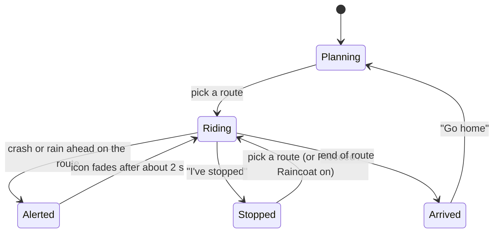

# Design brief: TrafficInsight

<!-- Filled in by plan-lens from the learner's interview. Use the learner's words. Mark any value they didn't choose as (default). -->

## The one spatial moment
I'm riding my motorcycle to the office on route A. A chime plays and a short voice says a crash ahead has stalled traffic and to pull over to see options. I pull over. There is no table at the roadside, so the full map appears floating in front of me, and the routes light up on the road ahead with a mark where they split. The map shows the rest of my route with the crash stretch highlighted, and route B beside it, both compared by time, fuel and weather, with the part I've already ridden shown dim and a clear "you are here" marker. I pinch route B, a voice says the new route is set, the map and the road marks go away, and I ride on and get to the office on time.

The demo tells this as one day, in two trips that reuse the same map, alert and stop:
1. **Morning, at home:** the map on the table shows the trip to the office with time, fuel and the other important info. I pick a route.
2. **On the road:** nothing on screen, and no table. Then the crash alert, pull over, the map floats in front of me and the routes show on the road ahead, reroute, arrive on time.
3. **Evening, going home:** I see the route again and ride. A rain alert comes before the rain zone. I pull over, see where the rain is and how bad it is, and either take the dry reroute or stay on my route and put on my raincoat. I ride through the rain prepared, and that's the happy part: being warned in time.

## Why it belongs on glasses
- Uses: leaves your body free, draws in the world.
- Why it's better than the phone or laptop version: while riding, my hands are on the handlebars and my eyes must stay on the road, so I can't use a phone. And I want to see the routes laid out in my space, not on a small flat map.

## Product or overlay
- Type: overlay. It responds to the real road, real traffic and real weather on my commute.
- What the real version would sense: my location and speed (GPS), whether I've stopped, live traffic and incidents (crashes), live weather along the route, and my voice ("office", "route B").
- Stand-in for the preview: see the table below. The rule the learner set: we know what the product should be. Anything the preview can't do becomes a button or another simple input, and the README and video say so truthfully.

| Real product | Preview stand-in |
|---|---|
| I say "office", or use a saved shortcut | A "Go to office" button (morning) and a "Go home" button (evening) |
| If my destination is unclear, it asks which one I mean | One hard-coded clarifying question, "Which office: Main office or Branch office?", with a button for each (default wording) |
| GPS follows me along the road | A **Ride simulator** panel: a button moves my position along the route (default) |
| The Lens detects that I've pulled over | An "I've stopped" button on the Ride simulator panel |
| Live traffic and crash reports | Hard-coded: a crash on morning route A that adds +18 min (default number) |
| Live weather along the route | Hard-coded: rain on evening route A between km 4 and 7, 24 °C, heavy, "windy rain" (temperature, intensity and type are defaults) |
| Route time and fuel from a routing service | Hard-coded sample values for 2 routes per trip (default numbers) |
| Choosing a route by voice ("route B") | A button for every voice command, next to the pinch dots |
| The map lies flat on a real table or wall, or floats about 1 m in front of me if there's no flat surface | A virtual table in the room for the planning view at home. At the roadside the map simply floats about 1 m in front of me, with no table |
| The route drawn on the real road ahead (the real version needs my location and heading) | A mock street in the room with the route lines laid on it, shown only when I've stopped |
| Spoken alerts and confirmations | Spoken audio if it works in the preview. The same sentence also shows as a caption on the Ride simulator panel, so the demo never depends on it (default) |

**Two layers in the scene.** The *Lens* is what the rider would see on real glasses. The *Ride simulator* is demo scaffolding that only exists because the preview has no road. Keep them clearly separate: the simulator panel sits off to one side, labeled "Ride simulator (preview only)" (default). The "nothing on screen while riding" rule applies to the Lens layer only. The mock street stands in for the real road and exists only in the preview; the Lens's route lines and marks are drawn on it, and only while I'm stopped.

## Where things live
- Where the user is looking during the main task: in the stopped state, down at the map on the table in front of them. While riding, straight ahead at the road.
- **Route map (planning):** flat on a virtual table, about 60 × 40 cm (default), table top about 75 cm high (default), about 1 m in front of the user's start position (default) and a little below eye level. A simple, light-colored city map: roads as thin light lines, routes as thicker colored lines raised slightly off the map. No dark backgrounds, because black renders as transparent.
- **Route dots:** one big dot per route, about 4 cm across (default). Each sits on its own route line where the routes are furthest apart (default).
- **Route labels:** a small card next to each dot showing that route's time, fuel and weather. The recommended route (best time first, then fuel) is marked "Recommended".
- **Problem stretch highlight:** the crashed or rainy part of the remaining route gets a border or glow along the line.
- **Problem card:** sits on the highlighted stretch. Crash: "Crash, traffic stalled, +18 min" (default wording). Rain: temperature, rain intensity, and type (storm, windy rain, light rain).
- **Raincoat reminder:** a small panel just above the map, near the chosen route, with "Proceed" and "Raincoat on" buttons.
- **Alert icon:** small, about 4 cm (default), low in the view and never in the center, about 1 m away (default). It gently follows where the user looks so it stays in view (default).
- **Ride simulator panel:** to the user's right, about 1 m away, angled toward them (default). It holds a route progress bar, the "Ride" button, the "I've stopped" button, the trip buttons, the voice-command buttons and the caption line.
- **Floating map (stopped):** the same map, dots, labels and cards, with no table. About 1.1 m in front of the rider (default) and about 20 cm below eye level (default), facing the rider. It stays still once it appears.
- **Progress marks (stopped):** the part of the route already ridden is drawn dim. A clear "you are here" marker, larger than the home and office markers and in a bright accent colour (default). A small progress card, for example "Ridden 12 of 34 min" (default wording, numbers from the sample data).
- **Route on the road (stopped):** a mock street on the floor of the room a few metres ahead (default: straight, about 3 m wide, about 10 m long, one junction where route B turns off). Both route lines lie on it in vivid, saturated colours that stand out on the muted street (default). A pulsing ring marks where the routes split (default). The street, the lines and the floating map are all in view at the same time and must not cover each other; adjust their positions in the preview until they don't.

## Hands and input
- Choose destination: pinch "Go to office" or "Go home" (stand-ins for voice or a saved shortcut). If the destination is unclear, pinch the answer to the clarifying question.
- Choose a route: pinch the route's dot. Dragging isn't needed. The route lines on the road react to this: when I aim at a dot or a "Choose route" button, that route's line on the road brightens, and when I pick one, its line glows and the other fades.
- Raincoat reminder: pinch "Proceed" or "Raincoat on".
- Simulate the ride: pinch "Ride" on the Ride simulator to move along the route, and "I've stopped" to pull over.
- Targets are big and highlight when aimed at.
- Voice and the button that does the same job: "office" or "home" = the trip buttons; "route A" or "route B" = a "Choose route A" or "Choose route B" button on the simulator panel, plus the dots themselves; "proceed" or "raincoat on" = the reminder buttons.
- Alerted state: no hand input, voice only (learner's safety rule).

## When things show
Three states, for safety:

- **Planning (at home or at the office):** the virtual table is visible for the whole planning state, and once the destination is clear the map shows the whole trip on it, with route dots and labels. The table and map hide once a route is picked.
- **Riding:** nothing from the Lens on screen (no map, no table, no marks on the road), only short voice cues. Audio must not drown out traffic.
- **Alerted:** a chime plus one short sentence, and the small icon low in the view, which disappears after about 2 seconds. Morning: "Crash ahead on your route, traffic is stalled. Pull over to see options." (default wording). Evening: "Rain on your route in 10 minutes. Pull over to see options." Keep the tone calm (default).
- **Stopped:** the full picture. There is no table: the map floats in front of the rider, with the progress marks, the rest of the route with the problem stretch highlighted, the problem card, and a dot and label for each option. The routes are also laid on the mock street ahead, with a pulsing ring where they split. Morning: current route A and reroute B. Evening: the dry reroute (when available; in the sample data it is, at +12 min, a default number) and the rainy route.
- **After choosing:** a voice says "New route set" (default wording) and the map and the road marks hide, so you're back to riding.
- **Raincoat reminder:** shows only if the rainy route is chosen. Hides when "Proceed" or "Raincoat on" is pinched, and everything goes back to normal riding.
- **Arrived:** a short voice line, "You've arrived, on time." (default wording). Nothing stays on screen.
- If something needs attention out of view: the chime and voice do that job; the map only appears when the rider has stopped.

## Done criteria
Each one can be checked in Lens Studio's preview. Drafted from the learner's story, so confirm at review.
1. Pressing "Go to office" shows the map on the virtual table with two routes. Each has a big dot and a label with time, fuel and weather, and one is marked "Recommended". Pinching a dot picks that route and the map hides.
2. While riding, pressing "Ride" moves the progress bar on the Ride simulator, and nothing from the Lens is in view, including the table, until an alert.
3. At the crash point a chime plays, the alert sentence plays (and shows as a caption), and a small icon appears low in the view, not in the center, then disappears after about 2 seconds.
4. Pressing "I've stopped" after the crash alert shows the map floating in front of me (no table), with the rest of route A and the crash stretch highlighted, a delay card, plus route B. Pinching route B's dot plays "New route set" and hides the map, and riding on to the end plays the on-time arrival line.
5. On the evening trip, after the rain alert, pressing "I've stopped" shows the rainy stretch highlighted with a card for temperature, rain intensity and type. Pinching the rainy route's dot shows the raincoat reminder, and pinching "Proceed" or "Raincoat on" hides it and returns to riding.
6. The virtual table is visible while planning and hidden in every other state.
7. Pressing "I've stopped" puts the map about 1 m ahead and a little below eye level, in view.
8. When stopped, the part of the route already ridden is shown dim, with a clear "you are here" marker and a progress card, for example "Ridden 12 of 34 min".
9. When stopped, both routes are also shown laid on the mock street ahead, in vivid colours, with a pulsing ring where they split, and the street and the map do not cover each other. Aiming at a route's dot brightens its line. Choosing a route makes its line glow and fades the other. Riding hides all of it.

## Out of scope
- Real GPS, real navigation, live traffic and live weather (all hard-coded sample data).
- Turn-by-turn directions while riding.
- Detecting a real table or wall. The preview uses a virtual table for planning, and the map simply floats when I'm stopped.
- Showing the route on the real road. The mock street is a stand-in; real location, heading and how well a line would sit on the right lane are untested.
- A glance at the route while riding, and any route overlay on the road during the ride (parked: docs/backlog.md).
- Relying on voice recognition (every voice command has a button).
- Editing saved shortcuts.
- Data analytics, such as the best time to leave based on history.
- Mood music. (Calm wording in the alert voice is in scope.)
- Separate modes for cars or bicycles.

## Risks and open questions
- **Riding with AR glasses is unproven.** The learner's research note found no study of AR glasses on motorcycles or bicycles, and no Snap guidance about vehicles. The three-state design follows car and helmet-HUD evidence, but whether it's safe on a real bike is feel unproven and only real-world testing could tell. The video should say this.
- **Two trips is a lot to build.** Both reuse the same map, alert and stop, so the evening trip should be mostly new sample data. Build the morning trip end to end first.
- **Spoken audio may not work in the preview.** Captions on the simulator panel are the fallback.
- **Viewers may confuse the demo rig with the Lens.** Keep the Ride simulator clearly labeled and to the side.
- **The alert icon follows the view.** Content that sticks to the face is usually avoided. It's kept here because it's tiny, low and gone in 2 seconds. How it feels while moving is unproven.
- **A floating map at the roadside is unproven on a real bike.** The research found no study of AR glasses on two-wheelers. The map appears only after I've stopped and hides as soon as I ride on.
- **The road view is a stand-in.** How accurately a route line would sit on the real road is untested. The README and the video must say so.
- **The map and the road view could cover each other.** Both are shown when stopped, so check their positions in the preview.

## Build notes for CLAD
- Build for SPECS so it runs and can be demonstrated in Lens Studio's preview. No SPECS device is available.
- Use Spectacles Interaction Kit (SIK) and UI Kit for all interactions, so they work with the mouse in Interactive Preview and with LEAF.
- Build any stand-in exactly as described above, and keep it obvious in the scene.
- Use real-world scale in centimeters. Keep content inside the user's view during the main task.
- Use vivid, saturated colours for the route lines and marks, because the display is additive and bright colours read best. Keep the mock street itself muted so the lines stand out.
- Show or hide the table, the floating map, the progress marks and the road view from the state machine's snapshot, like everything else, so the tests can check them.
- The display is additive: black renders as transparent. Don't rely on black or very dark content to be seen; keep text light and readable from where the user stands.
- Get the basic flow working first, then add detail.
- Write LEAF scenarios for each done criterion, run them in preview, and report which pass. Say which criteria have no test.
- Don't record, identify, or follow people.

## After the build: judge it
This part is for you, after CLAD finishes.

1. **Does it work?** Ask your agent which LEAF tests passed and which done criteria have no test.
2. **Walk around it.** Open the preview in Interactive Preview. Use WASD to move, Q and E to go down and up, and right-drag (or hold Shift) to look around. Clicking acts as a pinch. Stand where a user would and look at the task.
3. **Ask the three questions.**
   - Does it use what I'm looking at?
   - Does it put something in my space, where it belongs?
   - Does it free my hands or let me keep my eyes up?
   - Would it be just as good on a phone? If so, what would make it need the glasses?
4. **Check comfort.**
   - Everything I need is in view while I do the task. Nothing sits at the edges, behind me, or stuck to my face.
   - Every control is within reach of someone standing there.
   - Text reads easily from where I stand. No dark UI disappearing.
   - Things show when needed and get out of the way.
5. **Label what you know.** Write "logic proven" next to anything the tests and preview show working, and "feel unproven" next to anything only real glasses could tell you (comfort over time, real hand tracking, real recognition).
6. **Fix with design notes, not code.** Tell your agent what to change in design terms, for example: "Move the step card 15 cm lower and next to the pan. Make the Next button twice as big. Re-run the tests." If a fix takes under a minute, like nudging a panel, do it yourself in the scene.
7. **Submit.** Record a video under 3 minutes of your Lens in the preview, public on YouTube. Make your repo public with your Lens Studio project and this `devpost/` folder. Details are on the hackathon site: https://learn-specs.devpost.com/resources
