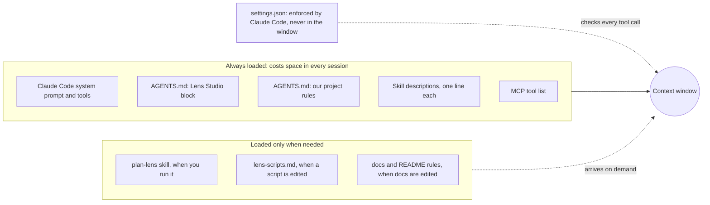
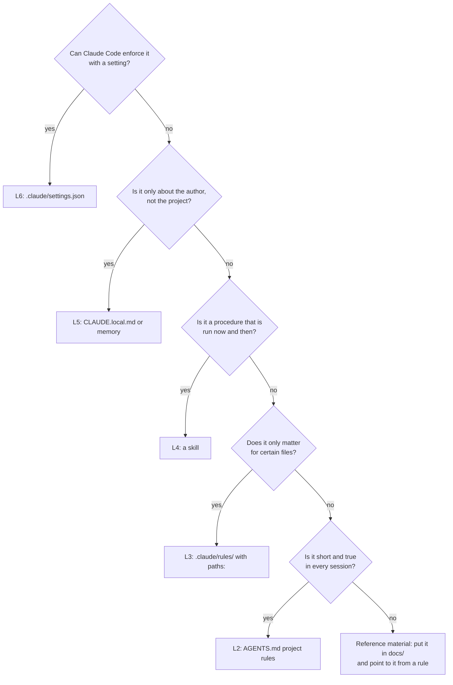
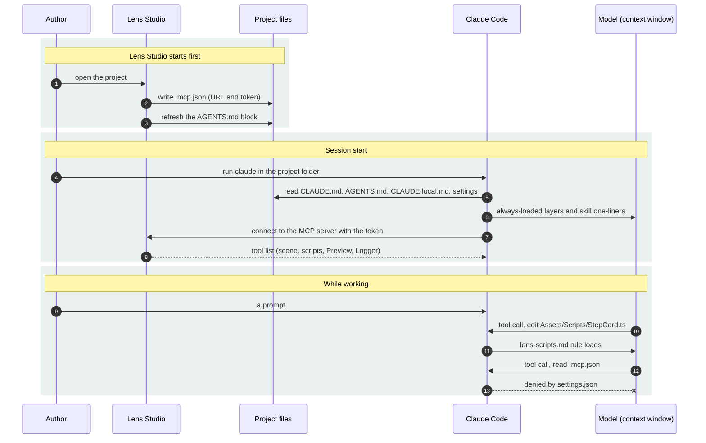

# Context engineering for this project

This document explains how the agents that work in this repository are given their instructions, and why the setup looks the way it does. Three agents share this folder: Claude Code (the general coding assistant), Devpost's `plan-lens` skill (which interviews the author and writes the design brief) and Snap's CLAD builders (which build the Lens). It is written both for readers who want to learn the ideas and for anyone who clones the repo and wants to reproduce the setup.

Everything here describes what is in the repository today. Where something was checked, the check is named. Where it was not, that is said too.

## 1. The core idea

A language model starts every session knowing nothing about this project. Whatever it "knows" was read into its **context window** (its working memory) at the start of the session. So the useful question is not "how do I make the agent smart about my project?" but "what goes into its context window, and when?".

More is not better. Snap's own guide for Lens Studio agents puts it like this:

> "The more information you add, the harder it gets for them to focus on what matters. Good context engineering finds the smallest set of high-value information that gets the result you want."

That leads to three tools, each with a different cost:

| Tool | When it reaches the agent | Cost |
|---|---|---|
| Always-loaded files (`AGENTS.md`, `CLAUDE.md`) | Every session | Takes space every time, so it must be short and always true |
| On-demand content (skills, path-scoped rules, docs) | Only when the task needs it | Almost free until used. This is called *progressive disclosure* |
| Enforced settings (`.claude/settings.json`) | Never read by the model. The program checks every tool call against them | Free, and a guarantee instead of a request |



## 2. The six layers

Each piece of context lives in exactly one layer.

| Layer | Owner | Files in this repo | Reaches the agent | Committed |
|---|---|---|---|---|
| L1 Lens Studio's managed blocks | Lens Studio | `AGENTS.md` (above the END marker), `CLAUDE.md`, the top blocks of `.gitignore` and `.gitattributes`, `Support/*.d.ts` | Every session (the agent files); the rest steers Git | Yes (`Support/` is ignored) |
| L2 Project rules | This repo | `AGENTS.md` (below the END marker) | Every session | Yes |
| L3 Path-scoped rules | This repo | `.claude/rules/lens-scripts.md`, `.claude/rules/docs-writing.md` | Only when a matching file is read or edited | Yes |
| L4 Skills and agents | Devpost, Snap | `plan-lens` (pinned in `skills-lock.json`), CLAD plugin | One line always, full text on use | Lockfile only |
| L5 Personal layer | The author | `CLAUDE.local.md`, `.claude/settings.local.json` | Every session on the author's machine | No |
| L6 Guarantees | This repo | `.claude/settings.json` | Never read; enforced on tool calls | Yes |

### L1 and L2 share a file

Lens Studio rewrites a block at the top of `AGENTS.md` every time it opens the project. The block is fenced by two comments, and Snap's documentation says everything between them is overwritten:

```text
<!-- BEGIN Lens Studio managed AGENTS block -->
   ... Lens Studio owns this ...
<!-- END Lens Studio managed AGENTS block -->

## Project rules
   ... we own this ...
```

Our rules sit below the END marker, which is where Snap's docs say custom rules belong. `CLAUDE.md` is generated by Lens Studio too and contains one line, `@AGENTS.md`, which tells Claude Code to read the shared file. This is the **generated-file pattern**: a tool owns part of a file and you add your own content outside its markers. `.gitignore` and `.gitattributes` follow the same pattern (see section 5).

Before writing our rules, the generated block was read in full and anything it already covers was left out. It already says never to modify `Cache/`, to read object positions before placing new ones, to use the Lens Studio MCP tools instead of raw HTTP, and to stop and report when an MCP tool fails. Repeating those would only spend space. Claude Code also strips HTML comments from these files before loading them, so the model never sees the BEGIN and END markers. Lens Studio, which rewrites the block, does.

### L3: rules that load only when relevant

A file in `.claude/rules/` with a `paths:` header loads only when Claude reads or edits a file that matches. TypeScript habits do not need to be in context while the README is written, and README style does not need to be in context while CLAD writes scripts. Path-scoped rules are a Claude Code feature. Other agents ignore `.claude/rules/`, which is why the rules every agent must follow are in `AGENTS.md`.

### L4: skills

A **skill** is a folder with a `SKILL.md` file: the instructions for one procedure plus reference files. The agent sees only its one-line description until the procedure is needed. `plan-lens` is a skill. **CLAD** (Closed Loop Agentic Development) is a plugin, a bundle of skills and subagents, installed into the author's Claude Code profile rather than this repository.

The skill was installed with a targeted command instead of the one the hackathon page shows:

```text
npx skills add challengepost/learn-specs --skill plan-lens -a claude-code --copy -y
```

The page's `--all` flag means "install all skills to all agents without prompts", which writes a copy for every coding agent the installer supports. Here that would fill the repository with folders for tools nobody uses. The installer also collects anonymous usage data unless `DISABLE_TELEMETRY=1` is set, which it was. The installed copy is git-ignored. `skills-lock.json` records the upstream commit and a hash of the files, like `package-lock.json`, so anyone can restore the same version.

### L5: the personal layer, and why it needs care

`CLAUDE.local.md` holds the author's working preferences (plan first, explain the reasoning, ask when unsure). It is loaded in every session on that machine, including the `plan-lens` interview and the CLAD build. Those workflows have their own rules, and a preference that is perfect in one session can break another:

| Preference | Normal session | `plan-lens` interview | CLAD build |
|---|---|---|---|
| Plan first and wait for approval | Helps | Fine | Conflicts: a build runs 30+ minutes unattended |
| Explain in detail, with diagrams | Helps | Conflicts: the skill asks for brief, warm replies | Noise mid-build |
| Ask with option lists | Helps | Conflicts: the skill forbids multiple-choice questions | Fine |

The fix is **scoping**. An instruction applies to a workflow, not to "the agent", so the personal file names the workflows that override it. The lesson: when you write an instruction, ask which sessions will read it.

### L6: guarantees

An instruction is a request, a setting is a guarantee. `.claude/settings.json` does three things:

- **`attribution`** is set to empty strings, which turns off the co-author line Claude Code adds to commits and the "generated with" line it adds to pull requests.
- **Deny rules** stop Claude's file tools from reading the files that hold the Lens Studio MCP token (`.mcp.json` and its editor-specific copies) and from editing `Cache/` and `Support/`, which Lens Studio regenerates.
- **Ask rules** require confirmation before `git push`, because pushing publishes.

Rule order is deny, then ask, then allow, and a deny cannot be overridden by an allow elsewhere.

## 3. Where does a new piece of context go?

Ask these in order and stop at the first yes. Enforcement comes first because a guarantee beats any instruction. Always-loaded files come last because that space is the most expensive.



## 4. How a session starts



- Lens Studio has to be running **before** Claude Code starts. Snap's docs: "Lens Studio has to be running before Claude Code starts, so Claude Code finds its server."
- The MCP port can change when Lens Studio restarts. If Claude cannot reach `lens-studio`, `/mcp` reconnects.
- Step 11 is progressive disclosure: the script rule arrives only once a script is touched.
- Step 13 is a guarantee: the model asked and Claude Code said no.

## 5. What was found while setting this up

Reading the real generated files, instead of assuming, changed the plan several times.

1. **Lens Studio manages `.gitignore` and `.gitattributes` once the project is in a git repository.** It prepends a managed block to each. The `.gitignore` block ignores `Cache/`, `Support/`, `Workspaces/`, `PluginsUserPreferences/`, `.vscode/`, `jsconfig.json`, `tsconfig.json`, `spk_debug_key.pem`, `*.lock`, and every connection file that holds the MCP token. The `.gitattributes` block sends the large files under `Assets/` and `Packages/` through Git LFS and forces LF for known text types. Our additions go **below** these blocks and are limited to what Lens Studio does not know about: `CLAUDE.local.md`, the installed skill copy, and LF for our own root and docs files. This was observed on two projects, so treat it as observed behavior rather than documented behavior.
2. **Git LFS needs a per-repository hook.** The LFS filters are configured system-wide, but the `pre-push` hook that uploads the real file content is per repository. Without it, a push sends only pointer files. `git lfs install --local` was run and the hook verified. See decision 0004.
3. **Line endings.** Git for Windows defaults to `core.autocrlf=true`, but every file Lens Studio writes uses plain LF, and its block only forces LF under `Assets/` and `Packages/`. A small path-specific block keeps the other text files on LF. A catch-all such as `* text=auto` was rejected because it would switch text conversion back on for LFS-tracked files.
4. **The template matters.** The first project was created with Lens Studio's plain "new project" (`fromTemplateName: Default`, empty `Packages/`). The SPECS Base Template that the hackathon documents includes the Interaction Kit, UI Kit, Motion and Icons packages and a scene with the Interaction Kit rig already set up. The project was rebuilt from the template. See decision 0005.
5. **A lock file leaks the machine name.** The `.esproj.<id>.lock` file holds Lens Studio's process id and the computer name. Lens Studio's own block ignores it with `*.lock`.
6. **The deny-rule path style matters, so it was tested.** A deny rule that matches nothing fails silently. Two path styles appear in Claude Code's documentation: `/path` (relative to the project root) and `./path` (relative to where Claude starts). Both were tested in a throwaway folder with decoy files: both styles blocked the Read tool and a control file without a rule was readable. This repo uses the `/path` style.
7. **Instruction files are loaded as expected.** A fresh Claude Code session started in the project quoted the project rules and the personal-layer exceptions correctly, which confirms the `CLAUDE.md` to `AGENTS.md` chain works.

## 6. Secrets: three layers for one token

The Lens Studio MCP server is protected by a token that lets any program on the machine control Lens Studio. Lens Studio writes it into several connection files. It is protected three ways, so one mistake does not expose it:

1. **`.gitignore`** (Lens Studio's managed block) keeps the files out of git.
2. **Deny rules** in `.claude/settings.json` stop Claude's Read and Edit tools from opening them.
3. **A rule in `AGENTS.md`** tells every agent not to stage, print or paste them.

Lens Studio also writes a small `spk_debug_key.pem` into the project and ignores it in the same block. Its name suggests a debug signing key; it was not opened and is never committed.

Limits, stated plainly: the deny rules were tested against the Read tool. Shell commands such as `Get-Content .mcp.json` are not guaranteed to be caught by them, which is why the other two layers exist. A token that is committed and pushed stays in git history even after the file is deleted. The only real fix then is replacing the token, so the order matters: ignore rules first, then the first `git add`. Lens Studio generates a new token each time it starts.

## 7. How to check any of this yourself

| Check | How |
|---|---|
| What is actually in the context window, and how big | `/context` in Claude Code |
| Which instruction files and memories loaded | `/memory` |
| Which permission rules are active | `/permissions` |
| Whether a file is ignored, and by which rule | `git check-ignore -v <path>` |
| Which files go through Git LFS | `git lfs ls-files` |
| How attribute rules resolve for a file | `git check-attr text eol filter -- <path>` |
| Whether Lens Studio's block was left alone | `git diff HEAD -- AGENTS.md` should show only additions after the END marker |
| That the skill matches its pin | `npx skills list` |

## 8. Reproducing the setup

1. Install Lens Studio 5.25 or later and turn on the **Core Chat Tools** and **Agents Docs** plugins in *Preferences > Plugins*. If they are missing, restart Lens Studio with your network connected (see the troubleshooting section in the README).
2. Clone the repository with Git LFS installed (`git lfs install` once, then run `git lfs install --local` inside the clone so the `pre-push` hook exists).
3. Open the project in Lens Studio, start the MCP server (*AI Assistant > AI Model Context Protocol (MCP) > Configure Server*), then start Claude Code from the project folder.
4. Install the CLAD plugin from inside Claude Code:
   ```text
   /plugin marketplace add https://github.com/lens-studio-devs/ls-extensions.git
   /plugin install ls-clad@ls-extensions
   ```
5. Restore the planning skill: `npx skills experimental_install -a claude-code` (reads `skills-lock.json`), or run the install command in section 2 above.
6. Optionally create `CLAUDE.local.md` for personal preferences. It is ignored by git.

See `docs/decisions/` for the reasoning behind the main choices.
