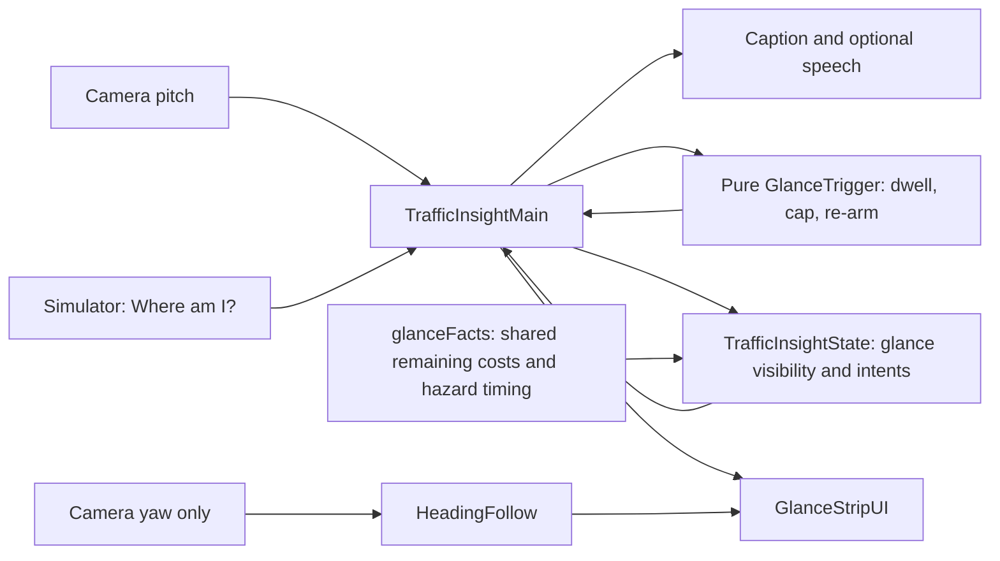

# 0008. A requested route glance while riding

Date: 2026-11-20 · Status: accepted

## Context

The author asked to implement the next planned feature: checking the route
while still riding. The agreed revision-two plan specifies a brief look-down
strip and an eyes-free answer. The full map and road stripes remain reserved
for stops. The author requested this build after approving Preview scenery.

## Decision

Make the strip the single requested exception to a clear riding view:

- Look down at least 20 degrees from the Preview's level baseline for 0.3 s.
- Show a 22 by 6 cm card about 1 m away, 25 degrees below the horizon. Follow
  yaw with smoothing; head pitch and roll do not drag the dashboard spot away.
- Show the active route as one straight line with the same route colours,
  dim ridden section, yellow rider, known problem interval and endpoint names.
  One line reports minutes left and the next known problem. No hand targets.
- Fade in over 0.15 s. Fade out over 0.3 s on looking up within 12 degrees,
  or before the deadline. The complete visual fits within a hard two-second
  cap; changing the Inspector cap cannot extend it beyond two seconds.
- Require a level look within 8 degrees for 0.5 s before another glance.
  Entering Riding, an interruption and a caption request also require this
  re-arm. Continuing to look down never reopens the strip automatically.
- Hide immediately on an alert, stop or arrival, without a lingering fade.
- Add Where am I? to the separate simulator as the voice-command stand-in.
  While Riding it dismisses any strip and reports the same facts by caption
  and optional speech, without changing progress or route. Outside Riding it
  says Ask while riding. During an alert it is blocked to protect the warning.

Speed-based voice-only restrictions remain a future-product note: the
simulator has no speed input. Speech recognition is not implemented; the
existing SDK caption fallback remains the demonstrated output.

## Implementation

The pure trigger receives pitch and time. Main samples the camera and passes
show/hide intents to the state machine. Only the state-owned `glanceStrip`
visibility flag enables the UI; the trigger also supplies fade opacity.
Snapshot visibility reads the actual panel. The scripted root stays enabled
so heading follow continues while the panel is hidden.

`glanceFacts` reuses `remainingStats`, problem fractions and route timing.
Before a warning, it says No reported problems and shows no hazard interval.
A known affected interval gets a countdown to entry or exit. A crash delay
contributes only while unpassed. After the interval or on the rerouted clear
route, it says Route clear. Strip and caption use the same facts.

The simulator panel is taller to fit the new button. It keeps its existing
world position and uses the same UI Kit/SIK button path. The strip uses a
non-interactive UI Kit card, text and small meshes; its material clones use
normal blending without depth writes so every part follows the fade.

## Validation

TypeScript compilation and runtime Logger checks succeeded; existing SDK
deprecation and renderer batching warnings remain. LEAF C1-C14 pass. C5
passed after resetting a turned Preview camera to the intended forward view.
The actual tilted Preview camera triggered the strip; fresh strip and caption
screenshots were inspected and linked in the README. C11
checks dwell, actual text, progress, placement and absence of colliders or
Interactables. C12 checks timing and re-arm. C13 checks shared numbers,
hazard boundaries, caption output and an empty Lens view. C14 checks blocked
states and interruption priority. The shared Lens-flag list includes the new
strip so the earlier riding-clear checks cover it too.

The head-pitch injection hook is editor-only and scenarios restore camera
sampling in `finally`. It does not change the heading anchor or journey.
Preview can verify these rules; real riding safety, posture thresholds,
heading-follow comfort, wind-noise speech recognition and performance on
Spectacles remain unverified on hardware.
