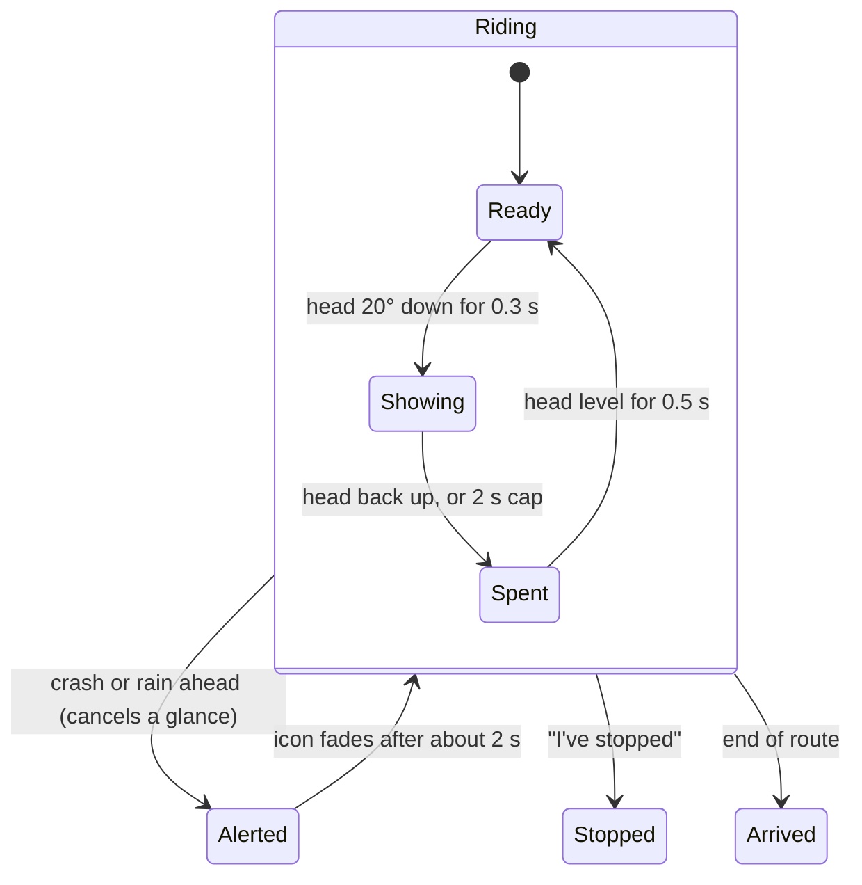
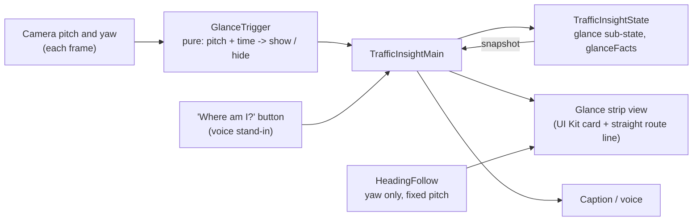

# Plan: a glance at the route while riding (revision 2)

| | |
|---|---|
| Status | **Built and verified in Preview on 2026-11-20.** LEAF C1-C14 pass; actual camera tilt and screenshots checked |
| Depends on | Revision 1 and consistency polish; trip-stage Preview surroundings now occupy C10 (built; LEAF C1 to C10 pass) |
| Replaces | The parked entry "A glance at the route while riding" in [docs/backlog.md](../backlog.md) |
| Source of truth | [devpost/design-brief.md](../../devpost/design-brief.md). The author requested implementation on 2026-11-20; the brief now includes C11-C14. The steps below preserve the agreed build plan |

This file is written so that any coding agent (Claude Code, Codex, Cursor or another) can pick it up cold. Read [AGENTS.md](../../AGENTS.md) first: its rules apply to every step here.

## 1. In one paragraph

While riding, the Lens shows nothing. This feature adds one exception the rider asks for. The rider **looks down at a "dashboard spot"** low in front of them, and a small **glance strip** appears there for **at most 2 seconds**. It shows the route as one straight line with "you are here", the minutes left, and the next problem. Or the rider **says "where am I?"** and hears the same facts, with **nothing shown**. Hands are never used. The full map stays reserved for when the rider has stopped.

## 2. Decisions taken

| # | Decision | Why |
|---|---|---|
| D1 | **Two triggers: look down (main) and voice (eyes-free).** No hand gestures | A rider's hands stay on the handlebars (the brief already bans hand input while Alerted for this reason). Looking down copies a habit riders already have (checking the instrument panel) and uses where the rider is looking. Voice keeps the eyes on the road entirely |
| D2 | **Voice gives a spoken answer only, no visual** | Drivers prefer spoken guidance (research note, RAC Foundation study). An answer by ear costs no glance at all |
| D3 | **The strip shows a straight route line, not a map** | A map has to be read (where am I, which line is mine, which way is up). A straight line from start to destination has nothing to orient, which fits a 2-second glance |
| D4 | **Text: minutes left + the next problem.** No "On route B" line | Two facts answer "how long" and "what's coming". The route letter adds reading without adding safety |
| D5 | **2-second cap, then look up to re-arm** | US car guidance: a single glance away from the road of at most 2 s. Re-arming stops a rider staring down by holding their head low |
| D6 | **Riding only; an alert always wins** | An alert is safety-critical. A glance never shows in Planning, Alerted, Stopped or Arrived, and an alert that fires mid-glance cancels it |
| D7 | **Low in the view, never in the middle of the road view** | The strip is below the normal view while the rider looks at the road. It is centred only when the rider deliberately looks down at it, like a speedometer |
| D8 | **Speed rule: real-product note only, not built** (confirmed by implementation scope, 2026-11-20) | The real product could answer by voice only above some speed. The Preview has no speed, so it is documented in the README's real-product notes, not implemented |

Evidence for D1 to D7 is in [docs/research/ar-ui-while-moving.md](../research/ar-ui-while-moving.md). **The look-down trigger itself is this project's idea, not something any source tested.** No source tests AR glasses on motorcycles or bicycles. Everything about how safe or comfortable this is on a real bike is *feel unproven*.

## 3. What the rider sees and hears

### 3.1 The glance strip

```text
 Home ●━━━━━━━━◉━━━━━▒▒▒▒▒▒━━━━━━━━━━━● Office
               you   rain
 18 min left · Rain in 6 min
```

- **Route line:** the active route, straightened into one horizontal line from start (left) to destination (right).
  - Ridden part dim, the same colour as the map's ridden stretch (`RIDDEN_COLOR` in `TrafficInsightRouteMap.ts`).
  - "You are here" in the same yellow as the map marker (`YOU_ARE_HERE_COLOR`).
  - The known problem stretch in coral (crash) or amber (rain), using the problem colours from the route map.
  - End labels "Home" and "Office", taken from the trip's `from`/`to` in `TrafficInsightTripData.ts`.
- **Text line:** `"{minutesLeft} min left · {next}"`, one line, large type.
- **Plate:** the same slate card style as the other Lens cards (additive display: mid-tone plate, white text, no near-black).
- **Size (default, tune in the Preview):** about 22 × 6 cm at about 1 m.
- **Nothing to pinch.**

### 3.2 Where it is

- **Placement (default, tune):** centred left-right, about 25° below the horizon, about 1 m from the eye. That is the "dashboard spot".
- **Following:** the spot follows the **bike's heading** (in the Preview, the camera's yaw, smoothed). It does **not** follow head tilt.
  - This matters. If it followed tilt, it would move down with the head and the rider could never look down *at* it.
  - **`TrafficInsightLazyFollow.ts` cannot be reused as-is.** It follows the camera's full pose, tilt included. Add a new component (proposed: `TrafficInsightHeadingFollow.ts`) that follows yaw only, with a fixed pitch below the horizon.

### 3.3 The look-down trigger (defaults, all tunable)

| Parameter | Default | Meaning |
|---|---|---|
| Baseline pitch | 0° in the Preview | The rider's normal head angle. Real product: a slow running average of head pitch while riding, ignoring time spent glancing |
| Show threshold | 20° below baseline | Head must tilt at least this far down |
| Dwell | 0.3 s | ...for at least this long, so a quick look at the road surface (a pothole) does not trigger it |
| Hide threshold | 12° below baseline | Hysteresis: the strip hides once the head comes back above this |
| Cap | 2.0 s | Hide after this even if the head is still down |
| Re-arm | head within 8° of baseline for 0.5 s | Required before the strip can show again |
| Fade | in 0.15 s, out 0.3 s | Soft edges, no pop |

The 20° threshold also keeps a slightly tilted Preview camera from triggering a glance by accident. Hand-driving tools in Lens Studio have been seen to leave the camera tilted about 5°.

### 3.4 The voice answer

- **Trigger:** the rider says "where am I?".
  - Preview stand-in: a **"Where am I?" button** on the Ride simulator panel. This follows the brief's pattern: every voice command has a button.
- **Answer:** `"{minutesLeft} minutes to {the office|home}. {Next sentence}."`
  - Example: "18 minutes to the office. Rain in 6 minutes."
  - In this SDK the text-to-speech module is deprecated, so spoken lines appear as captions on the simulator panel (existing behaviour, see the README's known limitations).
- **Nothing is shown in the Lens layer.**
- **Availability:** in Riding only (not Alerted). Elsewhere the button gives a short caption such as "Ask while riding.".

### 3.5 The facts, computed (one shared helper)

The current consistency pass already provides `remainingStats`, `plannedMinutesAt`, `sharedApproachFraction`, `problemSpan` and dynamic alert/card timing in `TrafficInsightTripData.ts`.

Build the future `glanceFacts` helper on those functions. Do not reintroduce `round((1 - progress) * wholeTripTime)`: the shared approach has the same elapsed cost on A and B, and a crash delay belongs to the affected stretch still ahead.

- Minutes left: round `remainingStats(...).timeMin`, choosing the incident-aware phase after the warning.
- Next problem: only known after the warning and only on the active route; compare progress with `problemSpan` and reuse the route timing for the start/end countdown.
- Before a warning, report No reported problems. Before a known problem, report its countdown; inside it, report time to leave the stretch. After it, or on the clear reroute, report Route clear.
- Both the strip and the voice answer use the same result. The current rain warning starts at 8 minutes, and later cards decrease consistently.
- At the 10% morning stop, the current sample reroute to B has about 38 minutes left, with no change to the roughly 2 minutes already ridden.

## 4. How it fits the Lens



"Where am I?" does not change the state. It produces a caption (and later speech) from `glanceFacts`.



Rules this must keep, already true of the codebase:

- **One-way data flow.** The state machine decides whether the strip is visible (a new `glanceStrip` flag in `LensVisibility`). `render()` shows or hides it from that flag, and nothing else toggles it.
- **The state module stays pure.** `TrafficInsightState.ts` gets no scene code. Head-pitch sampling and timers live in Main, as the alert and confirm timers do today.
- **Testable trigger logic.** The trigger is a pure function in its own module (proposed: `TrafficInsightGlanceTrigger.ts`), so LEAF tests can drive it without moving the camera.

## 5. Build steps (completed)

Each step ends with a compile and a read of the Lens Studio Logger. Each step that changes behaviour also ends with a LEAF run.

0. **Update the brief (author's approval required).** The brief is the source of truth, and the brief's owner (`plan-lens` / the author) approves edits.
   - The rule "Riding: nothing from the Lens on screen" gets one named exception: the glance strip, only when the rider looks down at it, at most 2 s.
   - Add the strip and the voice answer to *Where things live*, *Hands and input* and *When things show*.
   - Add two stand-in rows: "Looking down at the dashboard spot" = right-drag to look down in Interactive Preview, and "Saying 'where am I?'" = a button.
   - Add done criteria 11 to 14 (section 6).
   - D8: confirmed as a future-product note; the simulator has no speed input.
   - Preserve the current consistency rules in the brief.

   **0b. Resolved by the consistency pass (2026-11-20).** The old fixed ten-minute rain line was removed. The active-route warning now fires before the fork, and warning/card countdowns come from shared route timing. Reuse the existing helpers; do not restore the old 25% trigger or a fixed ten-minute sentence.

1. **Pure logic.**
   - `glanceFacts` in `TrafficInsightTripData.ts`.
   - `TrafficInsightGlanceTrigger.ts`: given pitch, baseline, time and its previous state, return Ready/Showing/Spent plus show/hide events.
   - No scene access in either.
2. **State.**
   - A glance sub-state of Riding in `TrafficInsightState.ts`: `glanceStart()`, `glanceEnd(reason)`, blocked outside Riding, cleared by any state change (an alert, "I've stopped", arrival).
   - `glanceStrip` in `LensVisibility` (`TrafficInsightTypes.ts`).
   - Snapshot fields for tests: `glance` (boolean), `glanceText`, `glanceSource`.
   - A `whereAmI()` intent that returns a caption built from `glanceFacts`.
3. **Views.**
   - New `TrafficInsightGlanceStripUI.ts`: one component, UI Kit card plus a straight route line built with the helpers in `TrafficInsightGeometry.ts`.
   - New root `GlanceStripRoot` in the scene, carrying the new `TrafficInsightHeadingFollow.ts`.
   - Add a "Where am I?" button to `TrafficInsightRideSimulatorUI.ts`, next to the existing voice-command buttons.
4. **Main.**
   - Each frame in Riding: read camera pitch, feed the trigger, call `glanceStart`/`glanceEnd`. Run the 2 s cap and the fades as the alert timer does.
   - Wire the button to `whereAmI()`.
   - Add a test hook so LEAF can inject a head pitch, because LEAF cannot turn the Preview camera. Proposed: `setHeadPitchOverrideForTests(deg | null)`, used only by scenarios.
5. **Tests.** LEAF scenarios C11 to C14 (section 6), one file each in `Assets/Tests/`, registered in `LeafIndex.ts`. Add `glanceStrip` to `LENS_FLAGS` in `TrafficInsightLeafDriver.ts`, so C2 and the other "Lens layer empty" checks also cover the strip. Re-run C1 to C14.
6. **Docs.**
   - README: walkthrough section with a screenshot of the strip. Take it with the Preview camera tilted down, then reset the camera.
   - Tests table, decisions, known limitations, roadmap.
   - Mark this plan as built.

## 6. Proposed done criteria and tests

Numbers follow the brief's existing criteria 1 to 10, including Preview surroundings. Each gets one LEAF scenario with the matching ID.

| ID | Done criterion (proposed wording for the brief) | How the test checks it |
|---|---|---|
| C11 | While riding, looking down at the dashboard spot for about 0.3 s shows the glance strip: the route as a straight line with "you are here", the minutes left and the next problem. Looking back up hides it | Inject a pitch of 25° down: hidden at 0.1 s, shown by about 0.55 s; text matches `glanceFacts`; inject 0°: hidden. Check the strip is below the horizon and centred left-right, measured from the eye position as C7 does |
| C12 | The strip never stays longer than about 2 seconds, and only shows again after the rider has looked back up | Hold 25° down: gone within 2 s of showing, including fades; still down at 4 s: not shown; level for 0.6 s, then down again: shown |
| C13 | Saying "where am I?" (a button in the Preview) gives the minutes left and the next problem as a spoken line (a caption), and shows nothing | Press the button while riding: caption equals the `glanceFacts` sentence; every Lens flag stays false |
| C14 | No glance outside riding, and an alert wins | Inject 25° down in Planning, Alerted, Stopped and Arrived: never shown. Start a glance, ride to the alert point: the glance ends and the alert icon shows |

The implementation also requires a level look after entering Riding or after any interruption. The caption request dismisses an active glance. Drawn progress and known hazard intervals are checked against the same trip fractions. See [decision 0008](../decisions/0008-requested-route-glance.md) and the [README](../../README.md) for final validation and screenshots.

## 7. What stays unproven

- Whether a 2-second look down is acceptable on a motorcycle, and whether the 20° / 0.3 s thresholds suit real riding postures (sport bike against scooter).
- Speech recognition in wind noise, and wearing the glasses under a helmet.
- Comfort of a heading-following anchor on a leaning, turning bike.

These go in the README as *feel unproven*. The Preview can prove the logic (triggers, cap, blocking, placement), not the feel.

## 8. Out of scope for this plan

- Turn-by-turn directions while riding (already out of scope in the brief).
- Any route overlay on the real road while riding.
- Showing the strip automatically at milestones (rejected: unrequested content while moving).
- Hand gestures while riding (rejected, D1).

## 9. Notes for the agent doing the work

- **Project rules:**
  - Follow [AGENTS.md](../../AGENTS.md), especially its project rules.
  - TypeScript, one component per file, in `Assets/Scripts/`. Log with `console.log`/`warn`/`error` (the project's `tiLog`/`tiWarn`/`tiError`).
  - After changing a script, compile and read the Logger before saying it works.
  - Commits use Conventional Commits with no co-author or "generated with" lines.
  - Never stage `.mcp.json`, `.cursor/mcp.json`, `.vscode/mcp.json` or `.codex/config.toml`.
- **Lens Studio access:** only through the Lens Studio MCP tools (named per runtime, see AGENTS.md), never raw HTTP.
- **Scene changes:** make them through the tools, then save the project; edits made in the editor are not on disk until saved. Saving re-creates the "LEAF Plugin Bridge" object with new IDs. That diff noise is harmless.
- **Preview quirks seen in this project:**
  - When a preview tool pinches a simulator button with the right hand, it can press a neighbour. Use the left hand, and check the log.
  - The first LEAF run after a recompile can time out. Run it again.
  - Hand-driving tools can leave the Preview camera tilted or turned. Reset it before screenshots. C7 and C9 measure from the eye *position* for this reason.
- **Where things are:**

| What | File |
|---|---|
| States, transitions, visibility | `Assets/Scripts/TrafficInsightState.ts` |
| Wiring, timers, render, LEAF snapshot | `Assets/Scripts/TrafficInsightMain.ts` |
| Sample data and text helpers | `Assets/Scripts/TrafficInsightTripData.ts` |
| Shared types / scene names | `TrafficInsightTypes.ts` / `TrafficInsightSceneContracts.ts` |
| Lens cards (UI Kit) | `TrafficInsightTrafficLensUI.ts` |
| Ride simulator panel (UI Kit) | `TrafficInsightRideSimulatorUI.ts` |
| Mesh helpers (ribbon, ring, puck, rect) | `TrafficInsightGeometry.ts` |
| Follows the camera (full pose, used by the alert icon) | `TrafficInsightLazyFollow.ts` |
| LEAF scenarios, driver, index | `Assets/Tests/` |
