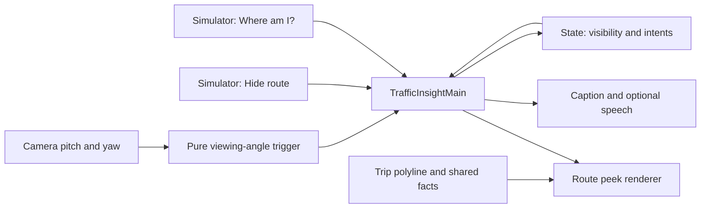

# Route peek while riding: current design

| | |
|---|---|
| Status | Implemented in `45dd3e0`; C1-C14 passed and fresh actual-camera visual review completed on 2026-11-22 |
| Source of truth | [Design brief](../../devpost/design-brief.md), criteria 11-14 |
| Supersedes | The straight progress strip and two-second limit in [decision 0008](../decisions/0008-requested-route-glance.md) |
| Current decision | [0009: route map and viewing angle](../decisions/0009-route-peek-viewing-angle.md) |

The author requested a map that shows the route's bends and their position,
with no duration cap while its viewing angle is held. This file describes
that revision. The original look-down strip was built earlier; its design
history is preserved in decision 0008 and Git.

## What appears

A compact map uses the same sample polyline as the planning/stopped map.
Origin is below, destination above, in both trips. The selected route keeps
its blue A or green B identity. The travelled path is dim, the rider is a
larger yellow marker, and a known unpassed problem interval is highlighted.
Endpoint names, selected route and schematic wording identify the context.
Remaining minutes and the next problem stay below the map.

The card is 24 by 18 cm at about 1 m, centred 25 degrees below the horizon.
It holds its heading during viewing and re-entry; looking aside must leave
its direction rather than drag the map along. There are no map hand targets.
Hide route is a button on the separate simulator, beside Where am I?.

Geometry is the existing sample route, not live geographic road data. Head
and camera direction control visibility; eye tracking is not implemented.
The full planning/stopped interface and road stripes remain hidden in Riding.

## Viewing rules

| Action | Result |
|---|---|
| Enter Riding, then look level within 8 degrees for 0.5 s | Arm the peek |
| Look down 20-40 degrees and within 15 degrees sideways for 0.3 s | Open the map |
| Keep looking within 12-45 degrees down and 22 degrees sideways | Keep it visible without a duration cap |
| Look straight, further down or aside | Fade out over 0.3 s |
| Look back into the same map direction | Reopen after the dwell |
| Press Hide route or Where am I? | Dismiss immediately; a fresh level look is required |
| Enter Alerted, Stopped, Planning or Arrived | Dismiss immediately; returning to Riding requires a fresh level look |

Opening fades in over 0.15 s. Different entry/exit angles provide hysteresis
so small head movements do not flicker the map. Explicit dismissal stays
respected while the user continues looking down.

Where am I? still gives the shared facts as a caption and optional speech,
with no Lens visual. Outside Riding it says Ask while riding. During an
alert the request is blocked so the warning keeps priority. Real speech
recognition is outside this build.

## Data and rendering

`glanceFacts` supplies the route points, remaining costs and known hazard.
`pointAt` places the rider by distance along the original polyline.
`slicePolyline` supplies the ridden and remaining problem sections before
the coordinates are scaled to the compact map. Each view uses the same
progress, rather than a second interpolation along a straight bar.

The state machine owns `glanceStrip` visibility. The legacy component and
snapshot names are retained for scene compatibility; they now render a map.
The pure trigger has no duration deadline. Main samples pitch/yaw and owns
the explicit-dismissal latch. HeadingFollow holds direction while viewing.

## Tests and remaining work

C11 checks the bent mesh, displayed facts, two-coordinate position, placement
and lack of map colliders/Interactables. C12 checks a held view beyond the
old cap, a one-hour synthetic trigger hold, look-away/re-entry, vertical
bounds and explicit dismissal. C13 checks shared estimates, bent hazard
geometry, actual caption output and empty Lens visibility after the request.
C14 checks blocked states, immediate interruption and active-peek arrival.
All four completed successfully in Preview on 2026-11-20.

Thirty further local logic checks passed, including a 24-hour synthetic
hold, both route branches, both trips, hazard boundaries and explicit
re-arming. Syntax checks on seven scripts passed. These local checks do not
replace Preview rendering or the previous scenarios.

Completed after MCP reconnection on 2026-11-22:

- Reset the Preview camera and ran all C1-C14 successfully.
- Inspected both route shapes and rider positions, readable text and panel
  boundaries. Actual-camera look-away/re-entry and Hide route behaved as specified.
- Captured the new route peek and simulator row into `docs/media/` and linked
  them in the README. The straight-strip capture remains revision history.

The unrestricted viewing duration is an author-requested prototype choice,
not a validated safe glance duration. Snap's [Spectacles best practices](https://support.spectacles.com/hc/en-us/articles/30214013362452-Best-Practices)
advise against using Spectacles while driving any vehicle. This remains a
Preview design concept; real vehicle use, hardware comfort, tracking and
speech recognition have not been verified.
