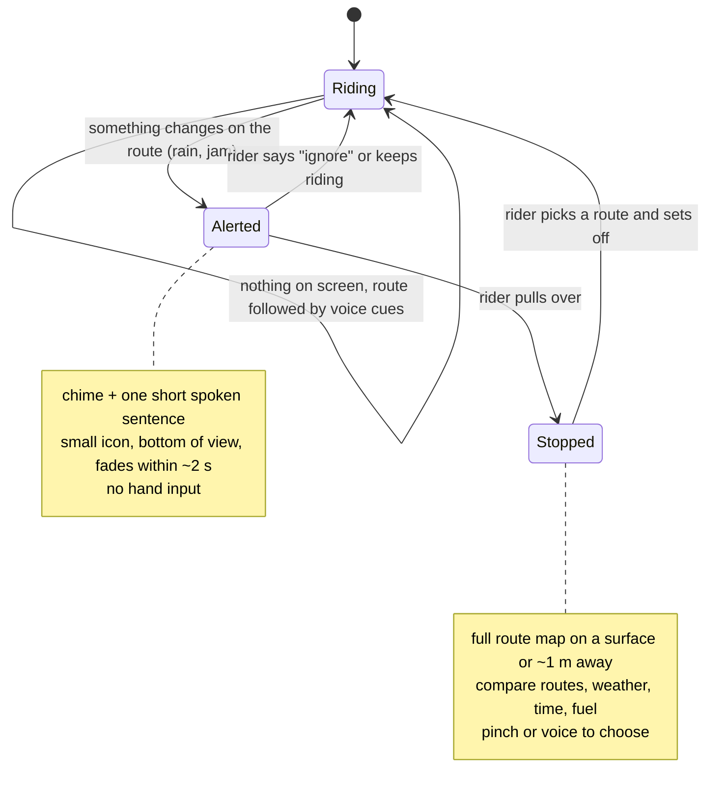

# Research: AR glasses UI while the user is moving

Question behind this note: TrafficInsight is aimed at motorcycle and bicycle commuters (cars too). While the rider is moving, what may the glasses show, how should alerts work, and what changes once the rider has stopped?

Researched on 2026-11-18. Every claim below links to its source. Where the evidence is weak or does not cover riders, that is said.

## Summary

| Finding | Strength of evidence |
|---|---|
| While moving, keep UI **small, glanceable, and only there when needed**. Long reading while moving is discouraged | Design guidance from Snap (legacy) and Google |
| Spoken guidance is **preferred** by drivers over visual guidance, and visual smart-glass guidance did not hurt driving performance compared with voice or a satnav | One on-road study, 16 car drivers |
| **Do not put alerts in the center** of the view. Bottom-center balanced distraction and workload best in a real car | One study, car co-pilots (10 real-world, 12 simulator) |
| A head-up display distracts riders **less than a phone**, and navigation cues in the **lower left or right** worked well | Motorcycle simulator studies (24 participants in one) |
| A glance away from the road should be **2 seconds at most**, 12 seconds in total per task; complex features belong to the **stopped** state | US car guidelines (voluntary, 2013) |
| Audio must **not drown out** surrounding sound | Google design guidance |
| Detailed content is comfortable at about **1 m**, world-anchored, centered in the view | Snap design guidance |
| **No source found covers AR glasses on motorcycles or bicycles**, and Snap's current docs carry no guidance or warning about vehicles | Gap |

## What the sources say

### Snap (SPECS and Spectacles design guidance)

Snap's **current** design docs default to world-anchored content: "Most content and interfaces should default to being world-anchored" ([Distance and units](https://docs.lensstudio.com/design/design-principles/distance-and-units)). The default distance is 110 cm, and 60 cm is for "Quick controls, short menus". Content can also anchor to the body, "keeping controls accessible as they move" ([Interactions](https://docs.lensstudio.com/design/design-principles/interactions)). For content outside the view: "provide clear visual or contextual cues to help users locate them" ([Field of view](https://docs.lensstudio.com/design/introduction/field-of-view)). Surface placement anchors content to "anything the user stands on or walks around" ([Surface placement](https://docs.lensstudio.com/design/design-principles/surface-placement)).

Snap's **legacy** Spectacles (2024) docs are more specific about motion: "For experiences designed to be used on-the-go and continuously in motion, UI that follows the user is easiest to interact with", and "It is best to keep the UI smaller and glanceable to avoid blocking the user's full field of view while in motion" ([Designing for movement](https://developers.snap.com/spectacles/best-practices/design-for-spectacles/designing-for-movement)). They distinguish *portability* ("The user stops their motion to open and interact with an interface") from *mobility* (interacting while moving). Detailed content "is most comfortable to view at approximately 1 meter away", lists should stay under seven items, and more than three windows "can feel overwhelming" ([Design best practices](https://developers.snap.com/spectacles/best-practices/design-for-spectacles/design-best-practices)). Near-field content (35 to 60 cm) is "Best for brief navigation and glanceable nearby controls" ([Positioning and sizing](https://developers.snap.com/spectacles/best-practices/design-for-spectacles/positioning-sizing-content)).

None of the Snap pages read mentions vehicles, cycling, riding or traffic, and none gives guidance on notifications or spatial audio.

### Google (Android XR display glasses)

Google's design principles: "Design UI to appear only when needed and recede when the task is complete", "Avoid sudden, distracting visual notifications that could obstruct the user's view at critical moments", "Avoid UI and motion that could induce motion sickness, such as expecting users to read large amounts of text while walking", and "If your app provides audio, the volume shouldn't block out environmental sounds" ([Design principles](https://developer.android.com/design/ui/ai-glasses/guides/foundations/design-principles)).

### Studies

- **AR glasses, car navigation** ([He and Zhou, 2024](https://arxiv.org/abs/2404.18357)). Five positions for a navigation arrow were compared on monocular glasses, in a simulator (12 people) and in a real car (10 people, riding as co-pilots for safety). The middle-center position was the most distracting in both settings. Bottom-center gave the best balance of distraction and workload in the real car. In the pilot, most people found central placement distracting and the information overwhelming. The authors note that a centrally placed cue may still be better for an urgent takeover request.
- **Smart glasses vs voice vs satnav, on the road** ([RAC Foundation, "Eyes on the road"](https://www.racfoundation.org/collaborations/eyes-on-the-road)). With 16 drivers, visual distraction from smart-glass navigation did not reduce driving performance compared with verbal directions or a satnav, but drivers clearly preferred verbal instructions.
- **Motorcycle head-up displays.** In a simulator study with 24 participants, head-up display tasks cut inappropriately long glances by 45 percent compared with smartphone tasks, and navigation on the head-up display did not concentrate gaze compared with normal riding ([Visual distraction effects, smartphone vs helmet HUD](https://www.researchgate.net/publication/328437186_Visual_Distraction_Effects_between_In-Vehicle_Tasks_with_a_Smartphone_and_a_Motorcycle_Helmet-Mounted_Head-Up_Display)). Other work found a helmet display lowered workload and improved speed-limit compliance and lane position compared with a head-down display ([Can a helmet-mounted display make motorcycling safer?](https://dl.acm.org/doi/10.1145/3172944.3172963)), and that navigation cues in the lower left or lower right were effective ([Head-up display for motorcycle navigation](https://www.researchgate.net/publication/263746987_Development_of_Head-Up_Display_for_Motorcycle_Navigation_System)).
- **Car distraction guidelines** ([NHTSA, 2013](https://www.nhtsa.gov/sites/nhtsa.gov/files/811820.pdf); [US DOT announcement](https://www.transportation.gov/briefing-room/us-dot-releases-guidelines-minimize-vehicle-distractions)). Voluntary guidance for in-car screens: a single glance away from the road of at most 2 seconds, at most 12 seconds in total for a task, and features such as text entry disabled unless the vehicle is stopped.

### Gaps and caveats

- No study found tests AR glasses on motorcycles or bicycles. The car and helmet-HUD findings are the closest evidence, and how well they transfer is unverified.
- The studies are small (10 to 24 participants) and mostly simulator-based.
- No Snap safety guidance about vehicles was found in the design docs, the SPECS terms of service, or specs.com. The general Snap terms and the Spectacles support site were not checked. Absence of a warning is not permission.

## What this means for TrafficInsight

Two states, with very different budgets for the rider's attention:

| | Riding | Alerted | Stopped |
|---|---|---|---|
| Visual | Nothing, or a minimal cue | A small icon, low in the view (never center), gone in about 2 s | The full picture: map, routes, weather |
| Audio | Short cues; must not drown out traffic | A chime and one short sentence | Normal |
| Input | Voice only | Voice only | Pinch and voice |
| Placement | n/a | Lower part of the view | World-anchored on a table or wall, or about 1 m away |

These are design proposals drawn from the evidence above, not tested results. The project's own decisions will be recorded in `devpost/design-brief.md`.
